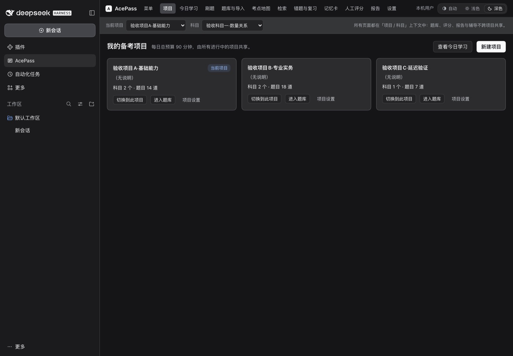
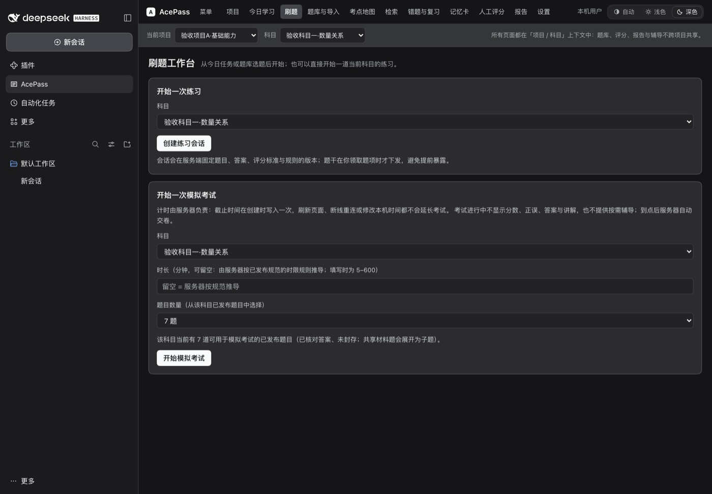
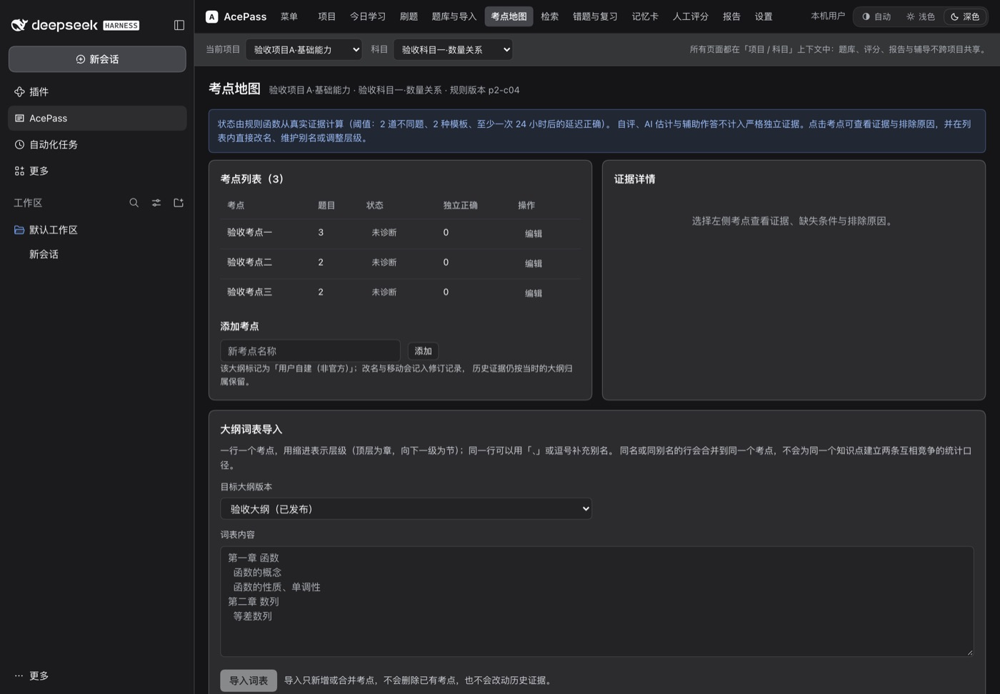

<div align="center">

# AcePass

**An evidence-first exam-prep system — it tells you what is worth studying next, where you are stuck, and what proves you can already do it.**

[简体中文](README.md) · English · [日本語](README.ja.md) · [한국어](README.ko.md)

[](https://github.com/cololi/acepass/actions/workflows/ci.yml)
[](LICENSE)
[](backend/requirements/lock.txt)
[](backend/requirements/base.txt)
[](frontend/package.json)
[](infra/docker/docker-compose.yml)



</div>

---

## What it is

AcePass is a **runnable, self-hosted, personalized exam-prep system** — not a frozen spec. It is built for the real
situation of preparing for several exams at once: one project maps to one exam goal and owns multiple subjects, and
the question bank, grading rules, reports and tutoring context are all scoped to that project/subject pair.

There is exactly one quality bar: **learning evidence outranks note counts and chat volume.** Every "mastered"
conclusion traces back to concrete answer records, the grading source and the time condition. When the evidence is
missing, the UI says "undiagnosed", "pending review" or "sample too small" instead of inventing a score.

It ships in two forms:

- **Standalone web app** — Django backend + React frontend; `docker compose` brings up the whole stack (TLS reverse proxy included).
- **DeepSeek Harness plugin** — `dsh-plugin/` is a native Node/TypeScript port of the same capabilities, mountable in the DSH sidebar.

## Capabilities

| Area | What it does |
|---|---|
| **Multi-project / multi-subject** | Projects, subjects, syllabus versions and grading specs are each versioned; switching a project switches the bank, reports, tutoring and caches together, not just the title |
| **Five question types** | Single choice, multiple choice, true/false, multi-blank fill-in, and constructed response — plus shared-material parent/child structure. Option IDs are stable and never follow display order |
| **Ingestion and review** | Paste text, manual entry, photo → structured draft; native-text PDF page-by-page layout classification (columns/tables/formulas/cross-page). **Nothing publishes without a "layout confirmed correct" step**, scanned pages go to manual entry, and no OCR is passed off as real text |
| **Deterministic grading** | Explicit per-type answer rules; fill-in supports exact / normalized / numeric-tolerance matching; incomplete rules send that blank to review, **never a guessed score** |
| **Humans and AI kept apart** | Constructed responses are confirmed rubric point by rubric point; AI estimates are written as separate "estimated" events and stay out of official totals until a human confirms; self-assessment and reviewer confirmation are tracked separately |
| **Evidence and state** | Six evidence dimensions, exclusion reasons and knowledge-point state rule functions; A/B/C paired questions with ≥24h delayed verification; an exposure ledger so switching projects cannot reset "unseen" |
| **Planning and review** | One daily budget shared across projects, explainable recommendations, FSRS memory cards with replayable logs, prerequisite graphs for weak-point repair |
| **Timed mock exams** | The deadline is written server-side — refresh, disconnect or a changed local clock cannot extend it; zero feedback during the exam, one-shot submission, server-side auto-submit at expiry |
| **Pluggable AI** | OpenAI-compatible endpoint, versioned prompts, deterministic validators, `llm_run` audit. With no key it says "AI not configured" and everything else keeps working |

<div align="center">


</div>

## Stack

| Layer | Choice |
|---|---|
| Backend | Python 3.12, Django 5.2, django-ninja, PostgreSQL 16, Celery + Redis (transactional outbox), pypdf |
| Frontend | React 19, Vite 6, TypeScript, TanStack Query, React Router 7, KaTeX (loaded on demand) |
| Testing | pytest (real PostgreSQL — never SQLite as a fallback), Vitest, Playwright (real browsers, mobile included) |
| Delivery | Docker Compose (8 services), nginx same-origin reverse proxy with TLS termination, GitHub Actions |

## Quick start

### Option A — local development

```bash
# 1) Backend
cd backend
python3.12 -m venv .venv
.venv/bin/pip install -r requirements/lock.txt -r requirements/dev.txt

# 2) Database and cache (or use infra/docker/docker-compose.yml)
brew services start postgresql@16 && brew services start redis
psql -d postgres -c "CREATE ROLE acepass WITH LOGIN PASSWORD 'acepass_dev_pw' CREATEDB;"
psql -d postgres -c "CREATE DATABASE acepass OWNER acepass ENCODING 'UTF8';"

# 3) Migrations and an account (no default password, no default admin)
export DJANGO_SETTINGS_MODULE=config.settings.dev
.venv/bin/python manage.py migrate
.venv/bin/python manage.py create_account you@example.com      # prompts for a password
.venv/bin/python manage.py load_demo_fixture --email you@example.com   # optional demo data, clearly labelled

# 4) Run
.venv/bin/python manage.py runserver 127.0.0.1:8000
curl -s http://127.0.0.1:8000/health/ready    # {"status":"ready","checks":{...}}
```

```bash
# 5) Frontend (second terminal)
cd frontend
npm install
npm run dev        # http://127.0.0.1:5173, /api proxied to 127.0.0.1:8000
```

Async workers (optional; without them events stay in the outbox and `audit.scan_outbox` can redeliver):

```bash
cd backend
.venv/bin/celery -A config worker -Q ingestion -c 2 -l INFO
.venv/bin/celery -A config worker -Q tutoring  -c 2 -l INFO
.venv/bin/celery -A config worker -Q projection -c 2 -l INFO
.venv/bin/celery -A config beat -l INFO
```

### Option B — Docker Compose (with TLS)

```bash
cp infra/docker/.env.example infra/docker/.env      # replace every change-me
bash scripts/gen-dev-certs.sh infra/docker/certs localhost   # self-signed, local only
docker compose -f infra/docker/docker-compose.yml --env-file infra/docker/.env up -d --build
# open https://localhost:8443 ; port 80 only performs a 301 redirect
```

Service layout, TLS contract, probes and restore flow: [infra/docker/README.md](infra/docker/README.md).

### Option C — as a DeepSeek Harness plugin

```bash
cd dsh-plugin
npm run build        # emits lib/, loaded by DSH as a bundle
```

The plugin manifest, locales and client injection points live in the `dsh` field of `dsh-plugin/package.json`.

### Configure a real AI provider (optional)

```bash
export ACEPASS_AI_PROVIDER=openai_compatible
export ACEPASS_AI_BASE_URL=https://your-endpoint/v1
export ACEPASS_AI_API_KEY=...        # never commit this
export ACEPASS_AI_TEXT_MODEL=...     # explanation, diagnosis, estimation
export ACEPASS_AI_VISION_MODEL=...   # image recognition; unset means explicitly unsupported
```

## Tests and gates

```bash
cd backend
.venv/bin/python -m pytest tests -q                    # unit + real PostgreSQL integration
.venv/bin/ruff check apps ai domain config tests       # lint
DJANGO_SETTINGS_MODULE=config.settings.dev .venv/bin/python manage.py check
DJANGO_SETTINGS_MODULE=config.settings.dev .venv/bin/python manage.py makemigrations --check --dry-run

cd ../frontend
npx tsc -b && npx vite build     # type check + production build
npx playwright test              # real browsers: desktop + mobile
```

Latest full record: backend **501 passed**, ruff/check/makemigrations clean, browser main suite **78 passed**,
stub-only run **8 passed**, three archived counterexample groups still passing. Numbers and per-rule details:
[implementation status](docs/implementation-status.md) and [acceptance results](docs/acceptance-results.md).

## Repository layout

```text
backend/
  config/{settings/{base,dev,test,prod},api,urls,celery}.py
  apps/{accounts,audit,exams,ingestion,question_bank,knowledge,practice,
        tutoring,learning,analytics,memory,search}/        # modular monolith, split by business domain
  apps/common/{enums,content,answers,scope,errors,api}.py  # shared contracts
  ai/{providers,prompts,validators}/                       # swappable AI capabilities + versioned prompts
  domain/{grading,memory,evidence,planning}/               # pure logic: grading adapters, FSRS, evidence rules
  tests/{unit,integration}/
frontend/
  src/{app,components,features,api}/                       # api split per domain; client.ts is only a compat barrel
  tests/{e2e,dsh}/
infra/{docker,proxy}/                                      # compose orchestration + same-origin proxy (TLS terminator)
dsh-plugin/                                                # DeepSeek Harness plugin (Node/TS port)
scripts/                                                   # backup/restore, certs, proxy and E2E checks
docs/                                                      # specs, architecture, per-round reviews and deliveries
```

## Documentation map

| Entry | Contents |
|---|---|
| [docs/README.md](docs/README.md) | Documentation index, grouped by topic |
| [Product spec](docs/01-product-spec.md) · [Architecture](docs/02-architecture.md) · [Domain and API](docs/03-domain-and-api.md) | What to build, how it is split, what the data contracts look like |
| [Implementation status](docs/implementation-status.md) · [Acceptance results](docs/acceptance-results.md) | **What actually ran and what did not** |
| [Delivery log](docs/CHANGELOG.md) | Per-round delivery records, newest first |
| [Deployment](infra/docker/README.md) | Service layout, TLS contract, probes, backup and restore |

## Known limitations

This repository deliberately writes down what is *not* verified instead of hiding it behind green checkmarks:

- **No real AI provider verification.** No usable credentials (the call returns HTTP 402, and that endpoint has no
  vision model), so explanation, image recognition, handwriting transcription, estimation, tag suggestions,
  embeddings and variant generation only have stub and degradation-path evidence.
- **No real ≥24h learning-effect verification.** Delayed verification has logic-level evidence with an injectable
  clock; nobody actually waited 24 hours.
- **No real exam material verification.** Fixtures are labelled "demo" everywhere; they are not any exam's official
  rules and not past papers.
- **No remote deployment verification.** Compose has been built and started locally, but there is no target server,
  domain or trusted certificate. The GitHub Actions workflows are part of this repository; their real execution
  status is whatever the Actions page shows.

## Contributing

Issues and PRs are welcome. Read [CONTRIBUTING.md](CONTRIBUTING.md) first: the gate here requires that **any change
to an assertion comes with a counterexample**, and the test commands above must pass before you submit.

## License

[MIT](LICENSE) © 2026 cololi
