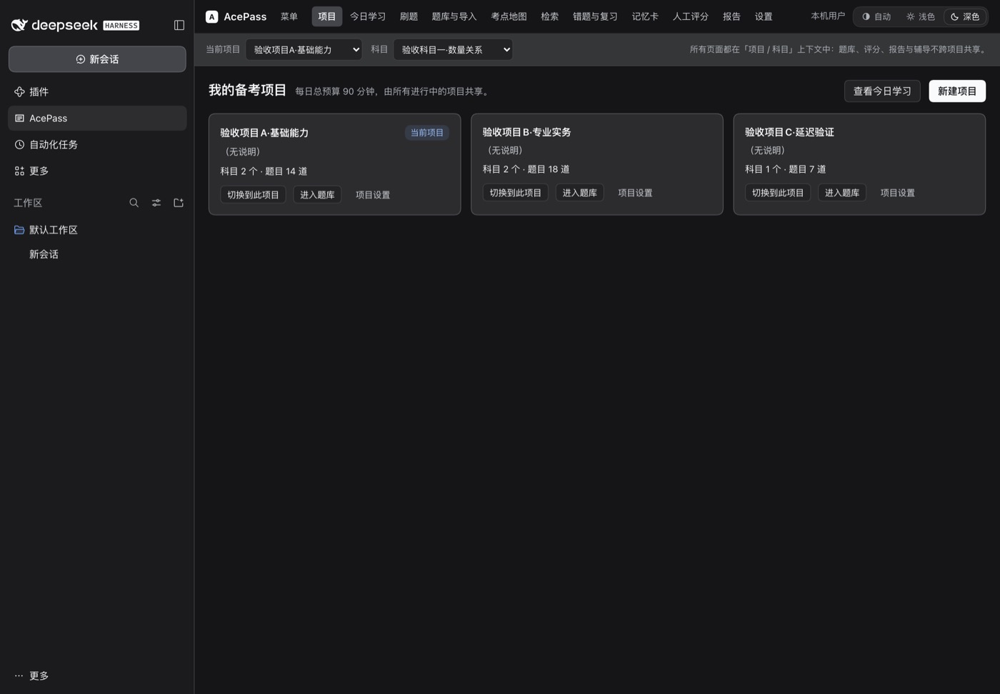
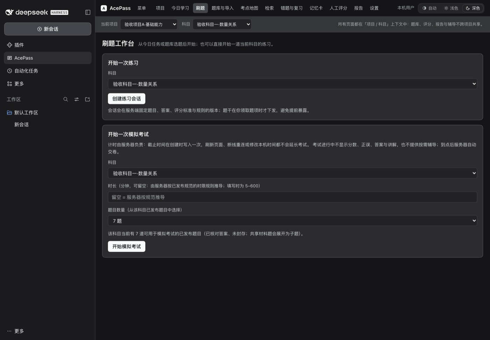
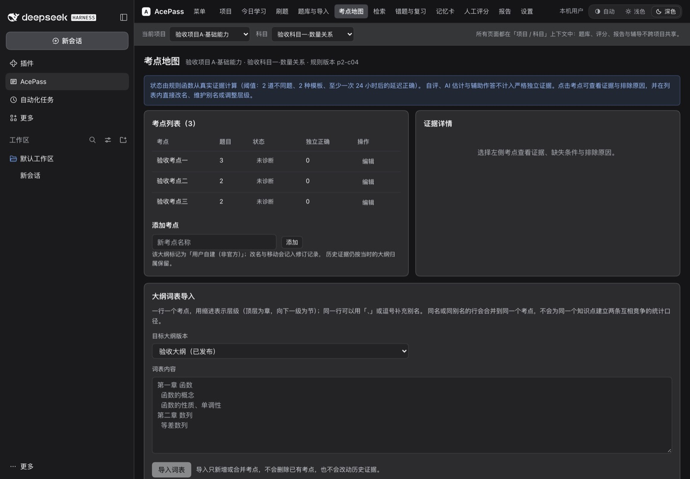

<div align="center">

# AcePass

**解答エビデンスを基準にした試験対策システム —— 次に何を学ぶ価値があるか、今どこで詰まっているか、なぜ「もう解ける」と言えるのかを示します。**

[简体中文](README.md) · [English](README.en.md) · 日本語 · [한국어](README.ko.md)

[](https://github.com/cololi/acepass/actions/workflows/ci.yml)
[](LICENSE)
[](backend/requirements/lock.txt)
[](backend/requirements/base.txt)
[](frontend/package.json)
[](infra/docker/docker-compose.yml)



</div>

---

## これは何か

AcePass は**実際に動くセルフホスト型の個別最適化された試験対策システム**であり、仕様書のスナップショットではありません。
複数の試験を同時に準備する現実を前提にしています。1 つのプロジェクトが 1 つの試験目標に対応し、その下に複数の科目を持ち、
問題バンク・採点ルール・レポート・チューターの文脈はすべてプロジェクト／科目単位で分離されます。

品質基準はただ一つです。**学習の証拠は、ノートの量やチャットの回数より優先される。**
「習得済み」という結論はすべて、具体的な解答記録・採点の出所・時間条件までたどれます。証拠が足りなければ、
画面はスコアを作らずに「未診断」「確認待ち」「サンプル不足」と表示します。

提供形態は 2 つあります。

- **スタンドアロン Web アプリ** — Django バックエンド + React フロントエンド。`docker compose` 一発で全スタック（TLS リバースプロキシ込み）が起動します。
- **DeepSeek Harness プラグイン** — `dsh-plugin/` は同じ機能を Node/TypeScript でネイティブ移植したもので、DSH のサイドバーに組み込めます。

## 主な機能

| 領域 | 内容 |
|---|---|
| **複数プロジェクト／複数科目** | プロジェクト、科目、シラバスのバージョン、採点仕様をそれぞれバージョン管理。プロジェクトを切り替えると問題バンク・レポート・チューター・キャッシュが一緒に切り替わります（タイトルだけ変わることはありません） |
| **5 つの出題形式** | 単一選択、複数選択、正誤、複数空欄の穴埋め、記述式。さらに共通素材の親子問題構造。選択肢 ID は安定しており、表示順に依存しません |
| **取り込みと校正** | テキスト貼り付け、手入力、撮影画像からの構造化。ネイティブテキスト PDF はページごとにレイアウトを分類（段組み／表／数式／ページ跨ぎ）。**「レイアウトに誤りなし」の確認なしには公開されません**。スキャンページは手入力へ回し、OCR でごまかしません |
| **決定的な採点** | 出題形式ごとに明示的な解答ルール。穴埋めは完全一致／正規化／数値許容差に対応。ルールが不完全な空欄は確認待ちへ送り、**推測で点を付けません** |
| **人と AI の分離** | 記述式はルーブリックの配点ごとに確認。AI の採点は「推定イベント」としてのみ記録され、人が確認するまで正式な合計に入りません。自己評価とレビュアー確認は別々に記録されます |
| **エビデンスと状態** | 6 次元のエビデンス、除外理由、知識点の状態ルール関数。A/B/C の対応問題と 24 時間以上の遅延検証。曝露台帳により「プロジェクトを変えれば未見に戻る」ことはできません |
| **計画と復習** | 複数プロジェクトで共有する 1 日の総予算、説明可能な推薦理由、FSRS 記憶カード（ログは再生可能）、弱点補強のための前提関係グラフ |
| **時間制限の模擬試験** | 締切はサーバー側で記録され、リロード・切断・端末時計の変更でも延長できません。試験中はフィードバックゼロ、提出は一度きり、期限到達でサーバーが自動提出します |
| **差し替え可能な AI** | OpenAI 互換エンドポイント、バージョン管理されたプロンプト、決定的バリデータ、`llm_run` 監査。キー未設定なら「AI 未設定」と明示し、他の機能はそのまま使えます |

<div align="center">


</div>

## 技術スタック

| レイヤー | 採用技術 |
|---|---|
| バックエンド | Python 3.12、Django 5.2、django-ninja、PostgreSQL 16、Celery + Redis（トランザクショナル・アウトボックス）、pypdf |
| フロントエンド | React 19、Vite 6、TypeScript、TanStack Query、React Router 7、KaTeX（オンデマンド読み込み） |
| テスト | pytest（実際の PostgreSQL。SQLite へのフォールバックなし）、Vitest、Playwright（実ブラウザ、モバイル含む） |
| デリバリ | Docker Compose（8 サービス）、nginx 同一オリジン・リバースプロキシと TLS 終端、GitHub Actions |

## クイックスタート

### 方法 A — ローカル開発

```bash
# 1) バックエンド
cd backend
python3.12 -m venv .venv
.venv/bin/pip install -r requirements/lock.txt -r requirements/dev.txt

# 2) データベースとキャッシュ（infra/docker/docker-compose.yml でも可）
brew services start postgresql@16 && brew services start redis
psql -d postgres -c "CREATE ROLE acepass WITH LOGIN PASSWORD 'acepass_dev_pw' CREATEDB;"
psql -d postgres -c "CREATE DATABASE acepass OWNER acepass ENCODING 'UTF8';"

# 3) マイグレーションとアカウント（既定パスワードも既定管理者もありません）
export DJANGO_SETTINGS_MODULE=config.settings.dev
.venv/bin/python manage.py migrate
.venv/bin/python manage.py create_account you@example.com      # パスワードを対話入力
.venv/bin/python manage.py load_demo_fixture --email you@example.com   # 任意：明示的に「デモ」と表示されるデータ

# 4) 起動
.venv/bin/python manage.py runserver 127.0.0.1:8000
curl -s http://127.0.0.1:8000/health/ready    # {"status":"ready","checks":{...}}
```

```bash
# 5) フロントエンド（別ターミナル）
cd frontend
npm install
npm run dev        # http://127.0.0.1:5173、/api は 127.0.0.1:8000 へプロキシ
```

非同期ワーカー（任意。未起動ならイベントはアウトボックスに残り、`audit.scan_outbox` で再送できます）:

```bash
cd backend
.venv/bin/celery -A config worker -Q ingestion -c 2 -l INFO
.venv/bin/celery -A config worker -Q tutoring  -c 2 -l INFO
.venv/bin/celery -A config worker -Q projection -c 2 -l INFO
.venv/bin/celery -A config beat -l INFO
```

### 方法 B — Docker Compose（TLS 込み）

```bash
cp infra/docker/.env.example infra/docker/.env      # change-me をすべて置き換える
bash scripts/gen-dev-certs.sh infra/docker/certs localhost   # ローカル専用の自己署名証明書
docker compose -f infra/docker/docker-compose.yml --env-file infra/docker/.env up -d --build
# https://localhost:8443 を開く。80 番は 301 リダイレクトのみ
```

サービスの構成、TLS の契約、ヘルスチェック、リストア手順は [infra/docker/README.md](infra/docker/README.md) を参照してください。

### 方法 C — DeepSeek Harness プラグインとして

```bash
cd dsh-plugin
npm run build        # lib/ を出力し、DSH がバンドルとして読み込みます
```

プラグインのマニフェスト、ロケール、クライアント注入点は `dsh-plugin/package.json` の `dsh` フィールドにあります。

### 実際の AI プロバイダーを設定（任意）

```bash
export ACEPASS_AI_PROVIDER=openai_compatible
export ACEPASS_AI_BASE_URL=https://your-endpoint/v1
export ACEPASS_AI_API_KEY=...        # Git にコミットしないでください
export ACEPASS_AI_TEXT_MODEL=...     # 解説・診断・採点推定
export ACEPASS_AI_VISION_MODEL=...   # 画像認識。未設定なら明示的に非対応
```

## テストとゲート

```bash
cd backend
.venv/bin/python -m pytest tests -q                    # ユニット + 実 PostgreSQL 統合
.venv/bin/ruff check apps ai domain config tests       # lint
DJANGO_SETTINGS_MODULE=config.settings.dev .venv/bin/python manage.py check
DJANGO_SETTINGS_MODULE=config.settings.dev .venv/bin/python manage.py makemigrations --check --dry-run

cd ../frontend
npx tsc -b && npx vite build     # 型チェック + 本番ビルド
npx playwright test              # 実ブラウザ：デスクトップ + モバイル
```

直近の完全な記録：バックエンド **503 passed**、ruff/check/makemigrations クリーン、ブラウザ本体スイート **78 passed**、
stub 専用 **8 passed**、アーカイブ済み反例 3 群もそのまま通過。数値と規定の詳細は
[実装状況](docs/implementation-status.md) と [受け入れ結果](docs/acceptance-results.md) にあります。

## リポジトリ構成

```text
backend/
  config/{settings/{base,dev,test,prod},api,urls,celery}.py
  apps/{accounts,audit,exams,ingestion,question_bank,knowledge,practice,
        tutoring,learning,analytics,memory,search}/        # モジュラーモノリス。業務ドメインで分割
  apps/common/{enums,content,answers,scope,errors,api}.py  # 共有契約
  ai/{providers,prompts,validators}/                       # 差し替え可能な AI 機能 + 版管理プロンプト
  domain/{grading,memory,evidence,planning}/               # 純粋ロジック：採点アダプタ、FSRS、エビデンス規則
  tests/{unit,integration}/
frontend/
  src/{app,components,features,api}/                       # api はドメイン別。client.ts は互換バレルのみ
  tests/{e2e,dsh}/
infra/{docker,proxy}/                                      # Compose 編成 + 同一オリジンプロキシ（TLS 終端点）
dsh-plugin/                                                # DeepSeek Harness プラグイン（Node/TS 移植）
scripts/                                                   # バックアップ／リストア、証明書、プロキシと E2E 検証
docs/                                                      # 仕様、アーキテクチャ、各ラウンドのレビューと納品記録
```

## ドキュメントマップ

| 入口 | 内容 |
|---|---|
| [docs/README.md](docs/README.md) | ドキュメント総索引（トピック別） |
| [製品仕様](docs/01-product-spec.md) · [アーキテクチャ](docs/02-architecture.md) · [ドメインと API](docs/03-domain-and-api.md) | 何を作るか、どう分割するか、データ契約の形 |
| [実装状況](docs/implementation-status.md) · [受け入れ結果](docs/acceptance-results.md) | **実際に実行したこと、していないこと** |
| [納品ログ](docs/CHANGELOG.md) | 各ラウンドの納品記録（新しい順） |
| [デプロイ構成](infra/docker/README.md) | サービス分割、TLS 契約、ヘルスチェック、バックアップと復元 |

## 既知の制限

このリポジトリは、緑のチェックで隠すのではなく、**検証していないこと**を意図的に書き残しています。

- **実際の AI プロバイダーは未検証。** 利用可能な資格情報がありません（呼び出しは HTTP 402 を返し、そのエンドポイントには
  視覚モデルがありません）。そのため解説、画像認識、手書き転記、採点推定、タグ提案、埋め込み、変式生成は
  stub とフォールバック経路の証拠しかありません。
- **実際の 24 時間以上の学習効果は未検証。** 遅延検証には時計を注入できるロジック上の証拠はありますが、
  実際に 24 時間待った記録はありません。
- **実際の試験素材は未検証。** フィクスチャは常に「デモ」と表示され、どの試験の公式ルールでも過去問でもありません。
- **リモートデプロイは未検証。** Compose はローカルで構築・起動済みですが、対象サーバー・ドメイン・信頼された証明書はありません。
  GitHub Actions のワークフローは本リポジトリの一部であり、実際の実行状況は Actions ページの表示どおりです。

## コントリビューション

issue と PR を歓迎します。まず [CONTRIBUTING.md](CONTRIBUTING.md) をお読みください。このプロジェクトのゲートでは
**アサーションを変更するときは反例を同時に示すこと**が求められ、提出前に上記のテストコマンドを完走させる必要があります。

## ライセンス

[MIT](LICENSE) © 2026 cololi
