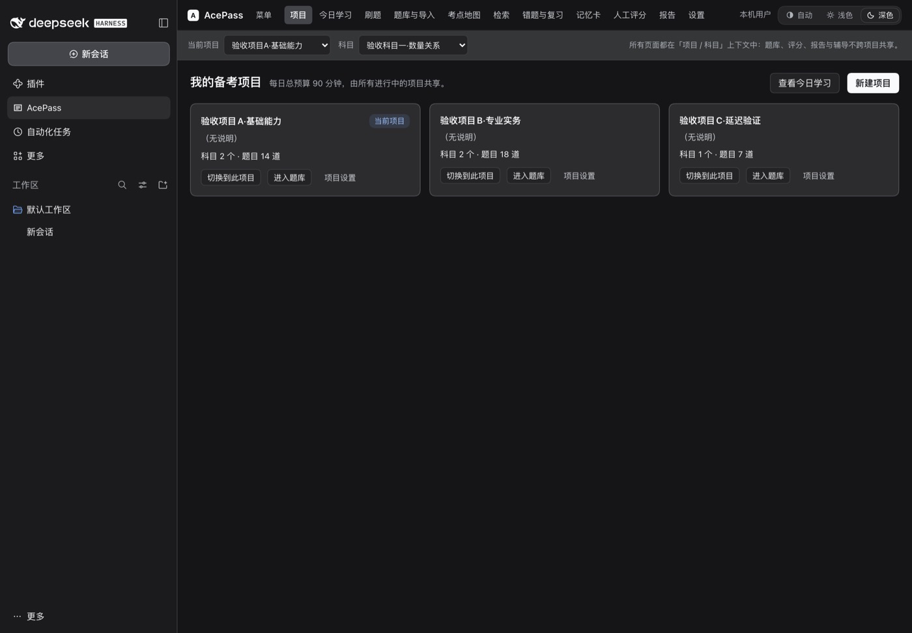
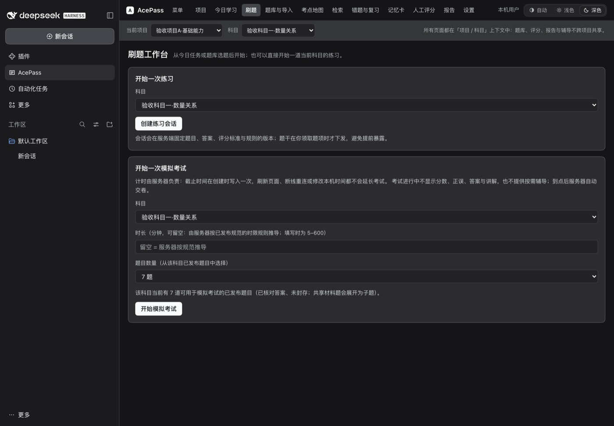
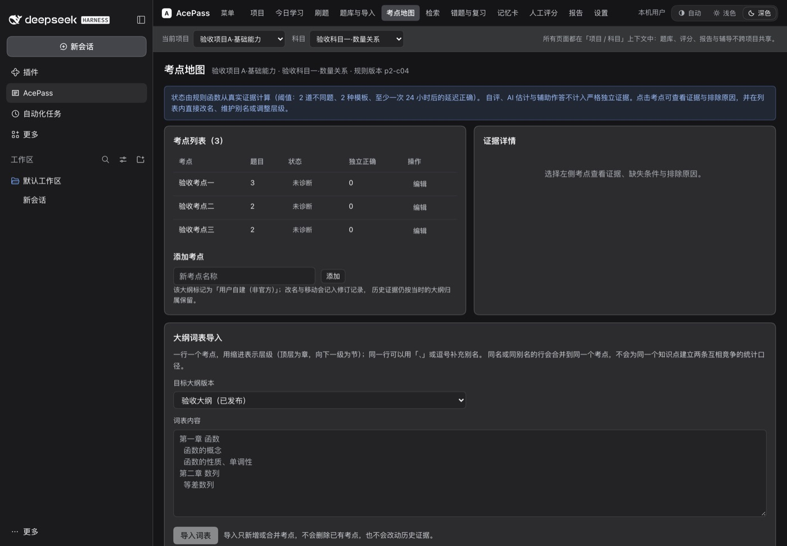

<div align="center">

# AcePass

**응답 증거를 기준으로 삼는 시험 대비 시스템 — 다음에 무엇을 공부하는 것이 가장 값진지, 지금 어디서 막혀 있는지, 무엇으로 "이미 할 수 있다"를 증명하는지 알려줍니다.**

[简体中文](README.md) · [English](README.en.md) · [日本語](README.ja.md) · 한국어

[](https://github.com/cololi/acepass/actions/workflows/ci.yml)
[](LICENSE)
[](backend/requirements/lock.txt)
[](backend/requirements/base.txt)
[](frontend/package.json)
[](infra/docker/docker-compose.yml)



</div>

---

## 무엇인가

AcePass는 **실제로 동작하는 셀프 호스팅 개인화 시험 대비 시스템**이며, 얼어붙은 명세서가 아닙니다.
여러 시험을 동시에 준비하는 현실을 전제로 합니다. 하나의 프로젝트가 하나의 시험 목표에 대응하고 그 아래에 여러 과목을 두며,
문제 은행·채점 규칙·리포트·튜터 문맥은 모두 프로젝트/과목 단위로 분리됩니다.

품질 기준은 단 하나입니다. **학습 증거는 노트 분량과 채팅 횟수보다 우선합니다.**
"습득 완료"라는 결론은 모두 구체적인 응답 기록, 채점 출처, 시간 조건까지 추적할 수 있습니다. 증거가 부족하면
화면은 점수를 지어내지 않고 "미진단", "검토 대기", "표본 부족"이라고 표시합니다.

제공 형태는 두 가지입니다.

- **독립 웹 앱** — Django 백엔드 + React 프런트엔드. `docker compose` 한 번으로 전체 스택(TLS 리버스 프록시 포함)이 뜹니다.
- **DeepSeek Harness 플러그인** — `dsh-plugin/`은 동일한 기능을 Node/TypeScript로 네이티브 이식한 것으로, DSH 사이드바에 붙여 쓸 수 있습니다.

## 핵심 기능

| 영역 | 내용 |
|---|---|
| **다중 프로젝트 / 다중 과목** | 프로젝트, 과목, 교육과정 버전, 채점 규격을 각각 버전 관리합니다. 프로젝트를 전환하면 문제 은행·리포트·튜터·캐시가 함께 전환되며, 제목만 바뀌지 않습니다 |
| **다섯 가지 문항 유형** | 단일 선택, 다중 선택, 참/거짓, 다중 빈칸 채우기, 서술형. 공유 자료의 부모/자식 문항 구조 포함. 선택지 ID는 안정적이며 표시 순서를 따르지 않습니다 |
| **가져오기와 교정** | 텍스트 붙여넣기, 수동 입력, 사진 → 구조화 초안. 네이티브 텍스트 PDF는 페이지별 레이아웃 분류(단/표/수식/페이지 넘김). **"레이아웃 확인 완료" 없이는 절대 게시되지 않으며**, 스캔 페이지는 수동 입력으로 보내고 OCR로 속이지 않습니다 |
| **결정적 채점** | 유형별 명시적 정답 규칙. 빈칸은 정확 일치/정규화/수치 허용 오차 지원. 규칙이 불완전한 빈칸은 검토 대기로 보내고 **점수를 추측하지 않습니다** |
| **사람과 AI의 분리** | 서술형은 루브릭 배점별로 확인합니다. AI 추정은 별도의 "추정 이벤트"로만 기록되어 사람이 확인하기 전까지 공식 총점에 들어가지 않습니다. 자기 평가와 검토자 확인은 따로 남습니다 |
| **증거와 상태** | 6차원 증거, 제외 사유, 지식 포인트 상태 규칙 함수. A/B/C 대응 문항과 24시간 이상 지연 검증. 노출 원장으로 "프로젝트를 바꿔 미확인으로 되돌리기"를 막습니다 |
| **계획과 복습** | 여러 프로젝트가 공유하는 하루 총 예산, 설명 가능한 추천 이유, FSRS 기억 카드(로그 재생 가능), 취약점 보강을 위한 선수 관계 그래프 |
| **시간 제한 모의시험** | 마감 시각은 서버에 기록되어 새로고침·연결 끊김·기기 시계 변경으로도 연장되지 않습니다. 시험 중 피드백 없음, 한 번만 제출, 만료 시 서버가 자동 제출합니다 |
| **교체 가능한 AI** | OpenAI 호환 엔드포인트, 버전 관리 프롬프트, 결정적 검증기, `llm_run` 감사. 키가 없으면 "AI 미설정"이라고 명시하고 나머지 기능은 그대로 동작합니다 |

<div align="center">


</div>

## 기술 스택

| 계층 | 선택 |
|---|---|
| 백엔드 | Python 3.12, Django 5.2, django-ninja, PostgreSQL 16, Celery + Redis(트랜잭션 아웃박스), pypdf |
| 프런트엔드 | React 19, Vite 6, TypeScript, TanStack Query, React Router 7, KaTeX(필요 시 로드) |
| 테스트 | pytest(실제 PostgreSQL, SQLite 폴백 없음), Vitest, Playwright(실제 브라우저, 모바일 포함) |
| 딜리버리 | Docker Compose(8개 서비스), nginx 동일 출처 리버스 프록시와 TLS 종단, GitHub Actions |

## 빠른 시작

### 방법 A — 로컬 개발

```bash
# 1) 백엔드
cd backend
python3.12 -m venv .venv
.venv/bin/pip install -r requirements/lock.txt -r requirements/dev.txt

# 2) 데이터베이스와 캐시 (infra/docker/docker-compose.yml 사용 가능)
brew services start postgresql@16 && brew services start redis
psql -d postgres -c "CREATE ROLE acepass WITH LOGIN PASSWORD 'acepass_dev_pw' CREATEDB;"
psql -d postgres -c "CREATE DATABASE acepass OWNER acepass ENCODING 'UTF8';"

# 3) 마이그레이션과 계정 (기본 비밀번호도 기본 관리자도 없습니다)
export DJANGO_SETTINGS_MODULE=config.settings.dev
.venv/bin/python manage.py migrate
.venv/bin/python manage.py create_account you@example.com      # 비밀번호를 대화형으로 입력
.venv/bin/python manage.py load_demo_fixture --email you@example.com   # 선택: "데모"로 명시된 데이터

# 4) 실행
.venv/bin/python manage.py runserver 127.0.0.1:8000
curl -s http://127.0.0.1:8000/health/ready    # {"status":"ready","checks":{...}}
```

```bash
# 5) 프런트엔드 (다른 터미널)
cd frontend
npm install
npm run dev        # http://127.0.0.1:5173, /api는 127.0.0.1:8000으로 프록시
```

비동기 워커(선택. 실행하지 않으면 이벤트가 아웃박스에 남고 `audit.scan_outbox`로 재전송할 수 있습니다):

```bash
cd backend
.venv/bin/celery -A config worker -Q ingestion -c 2 -l INFO
.venv/bin/celery -A config worker -Q tutoring  -c 2 -l INFO
.venv/bin/celery -A config worker -Q projection -c 2 -l INFO
.venv/bin/celery -A config beat -l INFO
```

### 방법 B — Docker Compose (TLS 포함)

```bash
cp infra/docker/.env.example infra/docker/.env      # 모든 change-me를 교체
bash scripts/gen-dev-certs.sh infra/docker/certs localhost   # 로컬 전용 자체 서명 인증서
docker compose -f infra/docker/docker-compose.yml --env-file infra/docker/.env up -d --build
# https://localhost:8443 접속. 80번 포트는 301 리다이렉트만 수행
```

서비스 구성, TLS 계약, 헬스 체크, 복원 절차는 [infra/docker/README.md](infra/docker/README.md)를 참고하세요.

### 방법 C — DeepSeek Harness 플러그인으로

```bash
cd dsh-plugin
npm run build        # lib/ 생성, DSH가 번들로 로드
```

플러그인 매니페스트, 로케일, 클라이언트 주입 지점은 `dsh-plugin/package.json`의 `dsh` 필드에 있습니다.

### 실제 AI 제공자 설정(선택)

```bash
export ACEPASS_AI_PROVIDER=openai_compatible
export ACEPASS_AI_BASE_URL=https://your-endpoint/v1
export ACEPASS_AI_API_KEY=...        # Git에 커밋하지 마세요
export ACEPASS_AI_TEXT_MODEL=...     # 해설, 진단, 추정 채점
export ACEPASS_AI_VISION_MODEL=...   # 이미지 인식. 미설정이면 명시적으로 미지원
```

## 테스트와 게이트

```bash
cd backend
.venv/bin/python -m pytest tests -q                    # 단위 + 실제 PostgreSQL 통합
.venv/bin/ruff check apps ai domain config tests       # lint
DJANGO_SETTINGS_MODULE=config.settings.dev .venv/bin/python manage.py check
DJANGO_SETTINGS_MODULE=config.settings.dev .venv/bin/python manage.py makemigrations --check --dry-run

cd ../frontend
npx tsc -b && npx vite build     # 타입 검사 + 프로덕션 빌드
npx playwright test              # 실제 브라우저: 데스크톱 + 모바일
```

최근 전체 기록: 백엔드 **508 passed**, ruff/check/makemigrations 깨끗함, 브라우저 본체 스위트 **78 passed**,
stub 전용 **8 passed**, 보관된 반례 3개 그룹도 그대로 통과. 수치와 규정별 세부는
[구현 상태](docs/implementation-status.md)와 [인수 결과](docs/acceptance-results.md)에 있습니다.

## 저장소 구조

```text
backend/
  config/{settings/{base,dev,test,prod},api,urls,celery}.py
  apps/{accounts,audit,exams,ingestion,question_bank,knowledge,practice,
        tutoring,learning,analytics,memory,search}/        # 모듈러 모놀리스, 업무 도메인별 분할
  apps/common/{enums,content,answers,scope,errors,api}.py  # 공유 계약
  ai/{providers,prompts,validators}/                       # 교체 가능한 AI 기능 + 버전 관리 프롬프트
  domain/{grading,memory,evidence,planning}/               # 순수 로직: 채점 어댑터, FSRS, 증거 규칙
  tests/{unit,integration}/
frontend/
  src/{app,components,features,api}/                       # api는 도메인별 분할, client.ts는 호환 배럴만
  tests/{e2e,dsh}/
infra/{docker,proxy}/                                      # Compose 오케스트레이션 + 동일 출처 프록시(TLS 종단점)
dsh-plugin/                                                # DeepSeek Harness 플러그인(Node/TS 이식)
scripts/                                                   # 백업/복원, 인증서, 프록시 및 E2E 검증
docs/                                                      # 명세, 아키텍처, 라운드별 리뷰와 납품 기록
```

## 문서 지도

| 입구 | 내용 |
|---|---|
| [docs/README.md](docs/README.md) | 문서 전체 색인(주제별) |
| [제품 명세](docs/01-product-spec.md) · [아키텍처](docs/02-architecture.md) · [도메인과 API](docs/03-domain-and-api.md) | 무엇을 만드는지, 어떻게 나누는지, 데이터 계약의 모양 |
| [구현 상태](docs/implementation-status.md) · [인수 결과](docs/acceptance-results.md) | **실제로 실행한 것과 하지 않은 것** |
| [납품 로그](docs/CHANGELOG.md) | 라운드별 납품 기록(최신순) |
| [배포 구성](infra/docker/README.md) | 서비스 분할, TLS 계약, 헬스 체크, 백업과 복원 |

## 알려진 제한

이 저장소는 초록색 체크로 덮는 대신 **검증하지 않은 것**을 일부러 적어 둡니다.

- **실제 AI 제공자는 미검증.** 사용 가능한 자격 증명이 없습니다(호출이 HTTP 402를 반환하고 그 엔드포인트에는 비전 모델이 없습니다).
  따라서 해설, 이미지 인식, 손글씨 전사, 추정 채점, 태그 제안, 임베딩, 변형 생성은 stub과 폴백 경로의 증거만 있습니다.
- **실제 24시간 이상 학습 효과는 미검증.** 지연 검증은 시계를 주입할 수 있는 로직 수준의 증거는 있지만, 실제로 24시간을 기다린 기록은 없습니다.
- **실제 시험 자료는 미검증.** 픽스처는 항상 "데모"로 표시되며 어떤 시험의 공식 규칙도, 기출문제도 아닙니다.
- **원격 배포는 미검증.** Compose는 로컬에서 빌드·기동했지만 대상 서버, 도메인, 신뢰된 인증서가 없습니다.
  GitHub Actions 워크플로는 이 저장소의 일부이며, 실제 실행 상태는 Actions 페이지가 보여 주는 그대로입니다.

## 기여

이슈와 PR을 환영합니다. 먼저 [CONTRIBUTING.md](CONTRIBUTING.md)를 읽어 주세요. 이 프로젝트의 게이트는
**단언을 바꿀 때 반례를 함께 제시**할 것을 요구하며, 제출 전에 위 테스트 명령을 모두 통과시켜야 합니다.

## 라이선스

[MIT](LICENSE) © 2026 cololi
