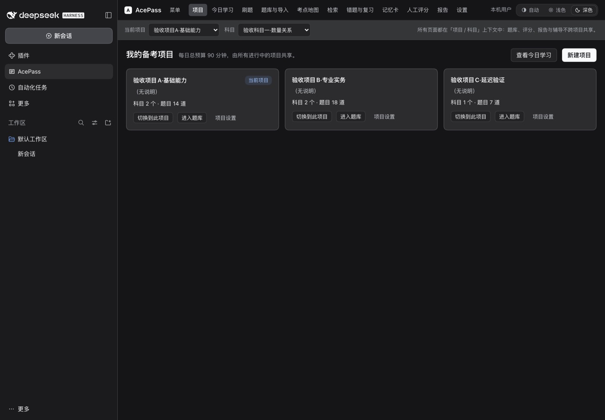
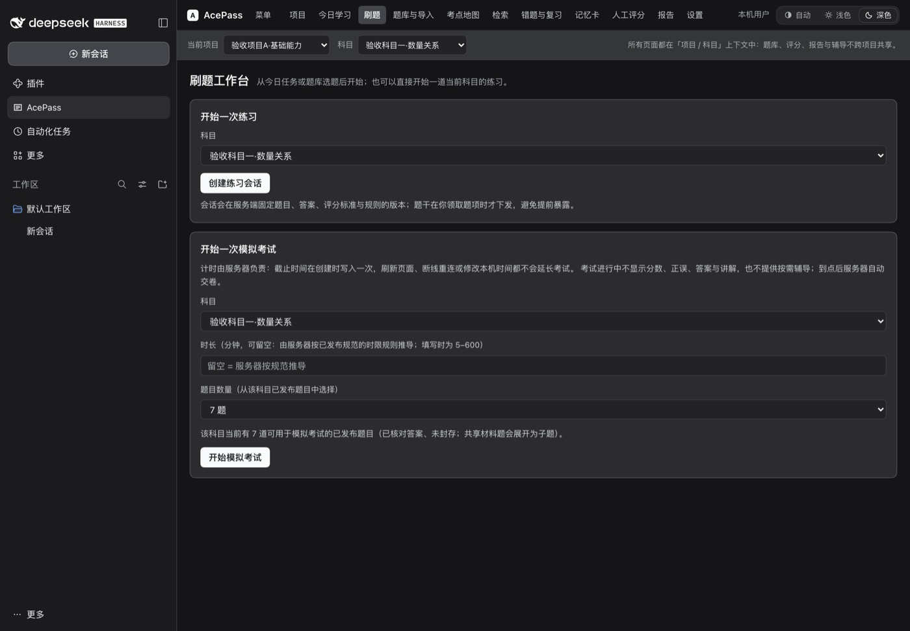
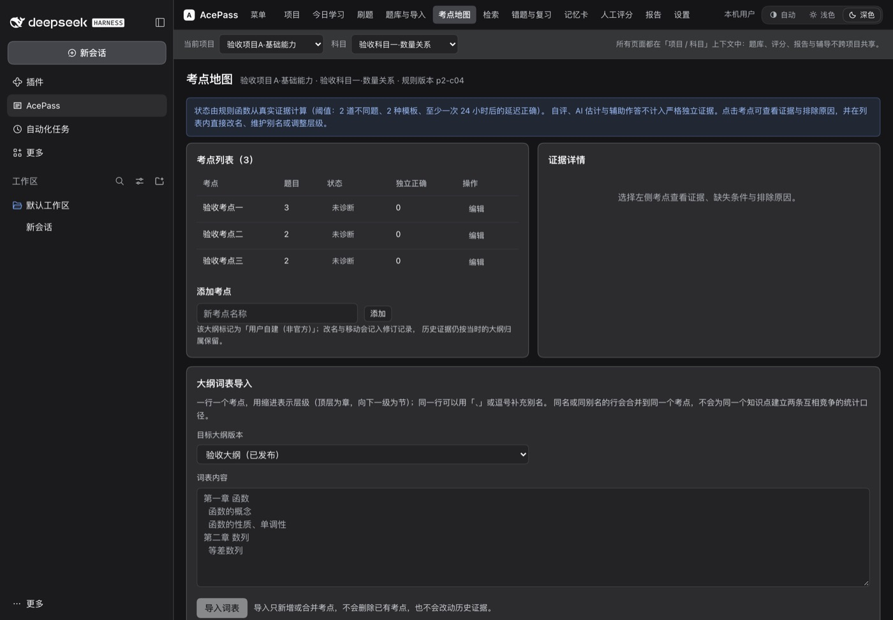

<div align="center">

# AcePass

**以作答证据为准的备考系统 —— 告诉你接下来学什么最值得、现在卡在哪里、凭什么证明你已经会做。**

简体中文 · [English](README.en.md) · [日本語](README.ja.md) · [한국어](README.ko.md)

[](https://github.com/cololi/acepass/actions/workflows/ci.yml)
[](LICENSE)
[](backend/requirements/lock.txt)
[](backend/requirements/base.txt)
[](frontend/package.json)
[](infra/docker/docker-compose.yml)



</div>

---

## 这是什么

AcePass 是一个**可运行、自托管的个性化备考系统**，不是规格文档的冻结快照。它面向「同时备考多个考试项目」的真实场景：
一个项目对应一个考试目标，下辖多个科目，题库、判分规则、报告与辅导上下文都按项目/科目隔离。

产品的判断标准只有一条：**学习证据优先于笔记数量和聊天次数**。所以系统里每一个「已掌握」结论都能追溯到具体的
作答记录、判分来源与时间条件；证据不足时它显示「未诊断」「待复核」「样本不足」，而不是编一个分数。

它同时提供两种形态：

- **独立 Web 应用**：Django 后端 + React 前端，`docker compose` 一条命令起全栈（含 TLS 反向代理）。
- **DeepSeek Harness 插件**：`dsh-plugin/` 是同一套业务能力的 Node/TypeScript 原生移植，可挂进 DSH 侧边栏使用。

## 核心能力

| 能力 | 说明 |
|---|---|
| **多项目 / 多科目** | 项目、科目、大纲版本、评分规范各自成版本；切换项目时题库、报告、辅导与缓存一起切换，不是只改标题 |
| **五种题型** | 单选、多选、判断、多空填空、大题，以及共享材料的父子题结构；选项 ID 稳定，不随显示顺序变化 |
| **导入与校对** | 粘贴文字、手工录入、拍照识别结构化；原生文字 PDF 逐页版式分类（分栏/表格/公式/跨页），**未经「确认版面无误」一律拒绝发布**，扫描页转人工录入，不做 OCR 冒充 |
| **确定性判分** | 按题型走显式答案规则；填空支持精确/归一化/数值容差；规则不完备时该空进入待复核，**绝不猜分** |
| **人工与 AI 分离** | 大题按 rubric 逐评分点确认；AI 估分只写「估计事件」，人工确认前不进正式总分；自评与他评分别留痕 |
| **证据与状态** | 六维证据、排除原因、考点状态规则函数；A/B/C 配对题与 ≥24 小时延迟验证；暴露台账防止「换项目重来」 |
| **计划与复习** | 多项目共享的每日总预算、可解释的推荐理由、FSRS 记忆卡（日志可重放）、考点前置关系补弱 |
| **限时模拟考试** | 截止时间由服务端写入，刷新/断线/改本地时钟都延长不了；考试中零反馈，交卷一次性，到期服务端自动交卷 |
| **AI 可插拔** | OpenAI 兼容接口，版本化提示词 + 确定性校验 + `llm_run` 审计；没配 key 时明确显示「AI 未配置」，其余功能照常可用 |

<div align="center">


</div>

## 技术栈

| 层 | 选型 |
|---|---|
| 后端 | Python 3.12、Django 5.2、django-ninja、PostgreSQL 16、Celery + Redis（事务性发件箱）、pypdf |
| 前端 | React 19、Vite 6、TypeScript、TanStack Query、React Router 7、KaTeX（按需加载） |
| 测试 | pytest（真实 PostgreSQL，不用 SQLite 兜底）、Vitest、Playwright（真实浏览器，含移动端） |
| 交付 | Docker Compose（8 个服务）、nginx 同源反向代理与 TLS 终止、GitHub Actions |

## 快速开始

### 方式 A：本机开发

```bash
# 1) 后端
cd backend
python3.12 -m venv .venv
.venv/bin/pip install -r requirements/lock.txt -r requirements/dev.txt

# 2) 数据库与缓存（也可用 infra/docker/docker-compose.yml）
brew services start postgresql@16 && brew services start redis
psql -d postgres -c "CREATE ROLE acepass WITH LOGIN PASSWORD 'acepass_dev_pw' CREATEDB;"
psql -d postgres -c "CREATE DATABASE acepass OWNER acepass ENCODING 'UTF8';"

# 3) 迁移与账户（没有默认密码，也没有默认管理员）
export DJANGO_SETTINGS_MODULE=config.settings.dev
.venv/bin/python manage.py migrate
.venv/bin/python manage.py create_account you@example.com      # 交互输入密码
.venv/bin/python manage.py load_demo_fixture --email you@example.com   # 可选：明确标注的演示数据

# 4) 起服务
.venv/bin/python manage.py runserver 127.0.0.1:8000
curl -s http://127.0.0.1:8000/health/ready    # {"status":"ready","checks":{...}}
```

```bash
# 5) 前端（另一个终端）
cd frontend
npm install
npm run dev        # http://127.0.0.1:5173，/api 代理到 127.0.0.1:8000
```

异步任务（可选；未启动时事件留在发件箱，可由 `audit.scan_outbox` 补发）：

```bash
cd backend
.venv/bin/celery -A config worker -Q ingestion -c 2 -l INFO
.venv/bin/celery -A config worker -Q tutoring  -c 2 -l INFO
.venv/bin/celery -A config worker -Q projection -c 2 -l INFO
.venv/bin/celery -A config beat -l INFO
```

### 方式 B：Docker Compose（含 TLS）

```bash
cp infra/docker/.env.example infra/docker/.env      # 改掉所有 change-me
bash scripts/gen-dev-certs.sh infra/docker/certs localhost   # 本机自签名证书
docker compose -f infra/docker/docker-compose.yml --env-file infra/docker/.env up -d --build
# 打开 https://localhost:8443 ，80 端口只做 301 跳转
```

服务划分、TLS 契约、探针与恢复流程见 [infra/docker/README.md](infra/docker/README.md)。

### 方式 C：作为 DeepSeek Harness 插件

```bash
cd dsh-plugin
npm run build        # 产出 lib/，由 DSH 以 bundle 形式加载
```

插件清单、locale 与客户端注入点见 `dsh-plugin/package.json` 的 `dsh` 字段。

### 配置真实 AI（可选）

```bash
export ACEPASS_AI_PROVIDER=openai_compatible
export ACEPASS_AI_BASE_URL=https://your-endpoint/v1
export ACEPASS_AI_API_KEY=...        # 不要提交到 Git
export ACEPASS_AI_TEXT_MODEL=...     # 讲解、诊断、估分
export ACEPASS_AI_VISION_MODEL=...   # 图片识别；不配置则明确不支持
```

## 测试与门禁

```bash
cd backend
.venv/bin/python -m pytest tests -q                    # 单元 + 真实 PostgreSQL 集成
.venv/bin/ruff check apps ai domain config tests       # lint
DJANGO_SETTINGS_MODULE=config.settings.dev .venv/bin/python manage.py check
DJANGO_SETTINGS_MODULE=config.settings.dev .venv/bin/python manage.py makemigrations --check --dry-run

cd ../frontend
npx tsc -b && npx vite build     # 类型检查 + 生产构建
npx playwright test              # 真实浏览器：桌面 + 移动端
```

最近的完整记录：后端 **501 passed**、ruff/check/makemigrations 干净、浏览器主套件 **78 passed**、
stub 专跑 **8 passed**、三组归档反例原样通过。数字与逐条规定见
[实现状态](docs/implementation-status.md) 与 [验收结果](docs/acceptance-results.md)。

## 目录结构

```text
backend/
  config/{settings/{base,dev,test,prod},api,urls,celery}.py
  apps/{accounts,audit,exams,ingestion,question_bank,knowledge,practice,
        tutoring,learning,analytics,memory,search}/        # 模块化单体，按业务域切分
  apps/common/{enums,content,answers,scope,errors,api}.py  # 共享契约
  ai/{providers,prompts,validators}/                       # 可替换 AI 能力 + 版本化提示词
  domain/{grading,memory,evidence,planning}/               # 纯逻辑：判分适配器、FSRS、证据规则
  tests/{unit,integration}/
frontend/
  src/{app,components,features,api}/                       # api 按域拆分，client.ts 只做兼容桶
  tests/{e2e,dsh}/
infra/{docker,proxy}/                                      # Compose 编排 + 同源反向代理（TLS 终止点）
dsh-plugin/                                                # DeepSeek Harness 插件（Node/TS 移植）
scripts/                                                   # 备份/恢复、证书、代理与 E2E 校验
docs/                                                      # 规格、架构、各轮评审与交付记录
```

## 文档地图

| 入口 | 内容 |
|---|---|
| [docs/README.md](docs/README.md) | 文档总索引（按主题分组） |
| [产品规格](docs/01-product-spec.md) · [架构](docs/02-architecture.md) · [领域与 API](docs/03-domain-and-api.md) | 要做什么、怎么划分、数据契约长什么样 |
| [实现状态](docs/implementation-status.md) · [验收结果](docs/acceptance-results.md) | **实际执行了什么、没执行什么** |
| [交付日志](docs/CHANGELOG.md) | 历轮交付的逐条记录（按时间倒序） |
| [部署编排](infra/docker/README.md) | 服务划分、TLS 契约、探针、备份恢复 |

## 已知限制

这个仓库有意把「没验证的事」写清楚，而不是用绿灯掩盖：

- **真实 AI provider 未验证**：没有可用凭据（调用返回 HTTP 402 余额不足，且该端点无视觉模型），
  因此讲解、图片识别、手写转写、估分、标签建议、嵌入向量、变式生成只有 stub 与降级路径的证据。
- **真实 ≥24 小时学习效果未验证**：延迟验证有可注入时钟的逻辑证据，没有真正等过 24 小时。
- **真实考试材料未验证**：夹具全程标注「演示」，不是任何考试的官方规则或真题。
- **远程部署未验证**：Compose 已在本机实际构建启动，但没有目标服务器、域名或受信任证书；
  GitHub Actions 的工作流是本仓库的一部分，实际执行状态以 Actions 页面为准。

## 参与贡献

欢迎 issue 与 PR。改动前请先读 [CONTRIBUTING.md](CONTRIBUTING.md)：本项目的门禁要求
「断言改变必须同时给出反例」，提交前请跑完上面的测试命令。

## 许可证

[MIT](LICENSE) © 2026 cololi
