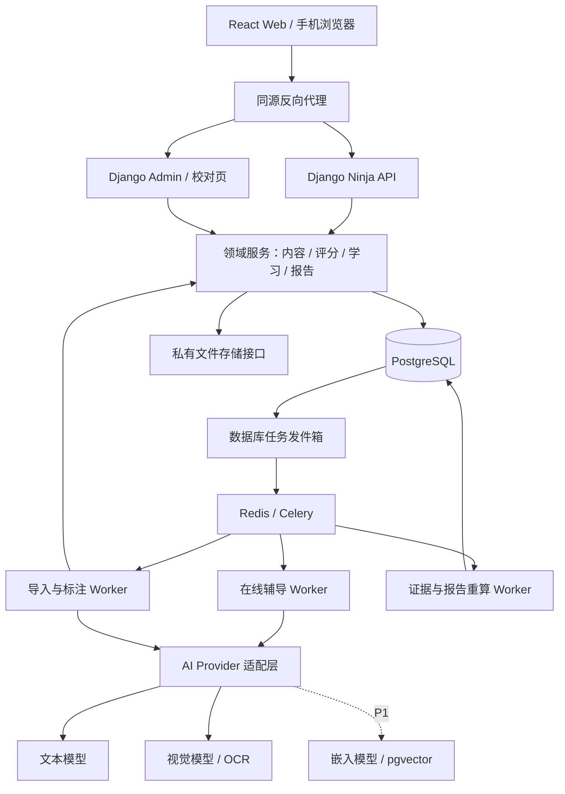

# AcePass 技术架构

## 1. 架构决策

采用模块化单体：前端独立构建，后端业务模块共享 PostgreSQL，异步 Worker 使用同一代码库和领域服务。题库、评分、证据、调度由确定性代码维护，AI 输出经过校验的候选内容。



## 2. 技术基线与引入时机

| 部件 | 决策 | 引入阶段 |
|---|---|---|
| 前端 | React + TypeScript + Vite；React Router；TanStack Query；KaTeX | P0 |
| 后端 | Python 3.12，Django 5.2 LTS 最新兼容安全补丁，Django Ninja | P0 |
| 运行 | ASGI 服务，反向代理同源部署；服务端保存认证会话 | P0 |
| 数据 | PostgreSQL 17 系列；Django ORM + 迁移；分值使用 Decimal | P0 |
| 异步 | Celery + Redis；数据库业务任务状态为真相 | P0 |
| 文件 | 私有本地目录 + Storage 接口；按需接入 S3 兼容存储 | P0 / 后续 |
| 搜索 | 项目内标签/题号/文本搜索；中文分词后混合检索 | P0 / P1 |
| 向量 | pgvector；不新增独立向量数据库 | P1 |
| 记忆调度 | py-fsrs，仅调度主动回忆卡 | P1 |
| 文档处理 | 原生 PDF 文本先行；复杂扫描评估 PP-StructureV3 | P1 / P2 |
| 工作流 | 普通 Python 服务 + 持久化任务状态；有实际分支需求再评估 LangGraph | P0 / 可选 |

Python 3.12 属于 Django 5.2 的支持范围；选择 5.2 LTS 是维护周期决策，不声称它是最新主版本。参见 [Django 支持版本](https://www.djangoproject.com/download/) 与 [Python 兼容范围](https://docs.djangoproject.com/en/5.2/faq/install/)。

前端使用满足所选 Vite 版本要求的受支持 Node LTS；由 M0 验证后固定 Node、npm、Python 镜像、直接依赖及传递依赖锁文件，不使用浮动 `latest` 镜像。参见 [Vite 安装条件](https://vite.dev/guide/)。所有上述精确依赖组合尚未实际安装验证。

## 3. 后端模块边界

| 模块 | 拥有的职责 | 禁止的越界 |
|---|---|---|
| `accounts` | 身份、用户预算、时区、会话 | 不能通过前端 user_id 选择身份 |
| `exams` | 项目、科目、大纲、考试规范、试卷发生记录、P2 模拟考试 | 不直接覆盖已使用评分规则 |
| `ingestion` | 私有材料、来源区域、导入候选、问题队列 | 不把模型结果直接发布 |
| `question_bank` | 题目身份、版本、答案/rubric、家族、发布服务 | 不写用户掌握状态 |
| `knowledge` | 考点、模板、前置关系和修订后的映射 | 不执行 LLM 统计 |
| `practice` | 会话题项、草稿、作答、暴露、评分事件 | 不接受客户端上报的权威分数/是否独立 |
| `tutoring` | 教学请求、诊断候选、解释、引用、模型调用 | 不直接写评分或学习任务 |
| `learning` | 有效证据、状态投影、今日计划、题目延迟复习、P1 记忆卡 | 不把缓存当原始事实 |
| `analytics` | 统计口径、报告快照、覆盖范围、重算 | 不把缺失数据当零 |
| `audit` | 操作、任务发件箱、模型记录、重算运行 | 日志不输出密钥/原始个人图片 |

写业务数据必须经过领域服务，Admin 的发布/评分/撤回也调用相同服务。API 负责鉴权、请求验证和 DTO；业务不塞进 router、模型 signal 或前端。跨模块依赖优先用 ID 和服务接口，避免循环导入。

建议目录（由 DeepSeek 实施创建，本次未生成应用骨架）：

```text
backend/
  config/{settings,urls,asgi,celery}.py
  apps/{accounts,exams,ingestion,question_bank,knowledge,practice,tutoring,learning,analytics,audit}/
  ai/{providers,schemas,prompts,retrieval,validators}/
  services/{grading,evidence,planning}/
  tests/{unit,integration,evaluation}/
frontend/
  src/{app,components,features,api}/
  src/features/{projects,imports,questions,practice,knowledge,review,reports}/
  tests/e2e/
infra/{docker,proxy}/
docs/
```

`services/grading` 由题型适配器组成：单选、多选、判断、分空规则、人工 rubric；P1 加 AI 估计适配器。所有适配器返回统一 GradeResult，类型不支持时返回待复核，不返回猜测分数。

## 4. 同源认证、作用域与文件

P0 使用 Django Session Cookie，CSRF 保护覆盖登录、提交、上传、评分和退出；生产启用 HTTPS、Secure/HttpOnly Cookie，前端开发代理 `/api` 避免不必要跨域。SessionAuth 是认证入口，对项目和对象的授权仍需逐项校验。[Ninja 认证](https://django-ninja.dev/guides/authentication/)；[Cookie 认证与 CSRF](https://django-ninja.dev/reference/csrf/)。

项目 P0 只有 owner；共享成员与角色不在首版。每个 QuerySet、文件下载、任务、缓存和模型检索都绑定 `owner_id + project_id`。内部 staff 可在显式授权下审核/评分，但本人给自己的作答评分仍算自评。跨项目访问必须显式且审计；校对者看到题目也记录该用户暴露。唯一的跨本人项目证据查询是已知内容谱系的暴露检查，不合并项目学习状态。已知管理员可通过数据库自查答案，不把个人系统宣称为防作弊平台。

学习题干图片与含答案的来源文件分开授权。整页同时包含其他题或答案时，仅提供审核后的题目区域；对无法安全裁剪的图片禁止用作独立测验题。原始答案页在提交前和考试中不能通过文件 URL 绕过访问规则。

文件通过认证下载或短期受控签名 URL 获取，存储对象路径不由用户直接指定。P0 接受 JPEG/PNG/WebP；PDF 在相应阶段开放。每张图片默认上限 10 MiB、25 MP，每道作答最多 6 张、累计 30 MiB；这些为可配置默认值。校验 MIME 与实际解码，清理 EXIF；SVG/HTML 不作为图片执行。题干和解析禁用原始 HTML、危险链接及任意 JS，KaTeX 采用非信任渲染。

## 5. 异步、事务与重试

使用三个队列：`ingestion`（识别/批量标注）、`tutoring`（在线生成）、`projection`（重判后证据和报告）。至少将在线与离线任务放到不同 Worker，保证大导入不耗尽在线并发。

业务事务内保存对象及 `outbox_event`；提交后触发派发，周期扫描补发未派发事件。数据库唯一键 + 行锁保证同任务重复投递不会重复发布/记分。不能只调用 `on_commit(task.delay)` 后就假设入队一定成功。Celery 的任务可能重投，幂等必须由业务保证。[Celery 任务与幂等说明](https://docs.celeryq.dev/en/stable/userguide/tasks.html)。

模型请求默认连接超时 10 秒、总超时 90 秒，最多 2 次退避重试；仅对临时网络/限流/可重试服务错误重试，认证错误和无效输入不循环。结构校验失败最多 1 次修复输出；所有调用共享原请求的费用和尝试次数预算。具体值配置化，用户可取消尚未发起的任务；对已调用但结果未知的请求标识费用可能已发生，不承诺恰好调用一次。

任务带输入版本指纹。旧任务晚到时若目标已撤回、版本变化或任务被替代，结果标记 stale，不覆盖新的答案、判分或计划。业务完成状态在 PostgreSQL，Redis 丢失可重派发，不能导致原始作答丢失。

## 6. AI 调用契约

能力接口：`extract_question`、`suggest_tags`、`explain`、`diagnose`、`estimate_grade`、`propose_variant`、`embed`。P0 只实现图片候选提取和按需讲解；其他按阶段启用。每个 provider 声明文本/视觉/结构输出/嵌入能力，文本模型不能被强行当视觉模型使用。

固定调用过程：权限和用途过滤 → 固定题目/答案/评分版本 → 检索直接关联资料 → 构建输入 → 调用模型 → schema/引用/规则验证 → 保存候选结果 → 由领域服务决定展示或审核。不授予模型任意数据库、文件或命令工具。

输入至少包含 `project_id, question_version_id, answer_key_version_id, rubric_version_id, syllabus_version_id, prompt_version, purpose`；个性化内容再包含作答 ID 与允许范围内的步骤。输出分为内容、来源 ID、缺失信息、诊断候选和建议后续操作，不能输出可直接写入的“掌握率”。引用 ID 必须存在于本次检索集合。

`llm_run` 保存提供商/模型标识、提示词版本、输入摘要与受控输入快照引用、响应校验结果、检索来源、用量、费用（未知则 null）、耗时、重试及错误。日志不默认保存完整图片与敏感姓名；原始敏感内容仅在私有受控存储中按策略保留。

P0 先返回 job ID 并轮询已校验完整结果；P1 加 SSE，采用 `progress / validated_section / done / error` 事件。未经验证的原始 token 不直接展示，避免流式输出绕过引用检查。断线可用事件序号重连，不重新调用模型。

无模型配置时手动录题、作答、判分、已有人工解析和复习仍能使用；AI 按钮明确提示未配置。测试 stub 必须只在测试/演示配置启用，并在 UI 标识，不能伪装成真实模型。

## 7. 检索、缓存与后续扩展

P0 顺序：固定题目版本 → 绑定可信答案/rubric → 已审核考点材料；按精确标签/题号搜索，中文子串搜索仅作为有限基础能力。P1 再引入固定版本中文分词器 + PostgreSQL 关键词索引，结合 pgvector 排序。检索在召回前过滤所有权限、大纲、审核状态与封存用途；重排序后再校验一次。pgvector 支持在 PostgreSQL 内保存向量并结合全文检索，具体中文分词需本项目额外实现。[pgvector 官方说明](https://github.com/pgvector/pgvector)。

基础解析缓存键包含权限范围、项目、题目/答案/rubric/大纲/资料版本、提示词、模型、语言和用途。个性化诊断另含用户、作答、上下文指纹。读取缓存也需重新鉴权和检查封存/撤回，不能只依赖写入时校验。

P1 主动回忆卡使用 py-fsrs，保存库版本、参数、卡片状态和不可变复习日志；它与题目延迟验证独立。FSRS 输出的卡片记忆估计不作为考试通过率。[py-fsrs 官方仓库](https://github.com/open-spaced-repetition/py-fsrs)。

P2 复杂扫描可评估 PP-StructureV3 的版面、表格和公式能力；先在项目人工金标集对比再启用，保留失败区域与人工校对，不预设本机 GPU 可承载全部组件。[PP-StructureV3 官方说明](https://github.com/PaddlePaddle/PaddleOCR/blob/main/docs/version3.x/algorithm/PP-StructureV3/PP-StructureV3.en.md)。

## 8. 部署、备份和可观测性

Docker Compose 服务：`web`（静态前端/代理）、`api`、`worker-ingestion`、`worker-tutoring`、`worker-projection`、`scheduler`、`postgres`、`redis`。它们仍属于同一应用；共享后端镜像，只改变启动命令。数据库/Redis 不暴露公网，媒体目录仅 API 与必要 Worker 挂载。

开发和部署配置分开，秘密只在环境变量或本机秘密文件，不提交 Git、不出现在前端构建变量。数据库和媒体持久化；每日备份数据库与文件清单，保留窗口默认 7 日可调，首次发布前在空目录恢复并核对作答/文件/版本引用。Redis 不纳入业务数据备份依据。

健康检查区分存活与就绪；模型不可用只使 AI 功能降级。每个请求和任务有关联 ID；观察导入成功/待校对率、队列延迟、判分重试、AI 用量、重算失败和图片访问失败。导入 OCR 准确率只能根据人工金标对比报告，不能用模型自报置信度替代。

P0 不配置具体远程机器、不安装 GPU 推理服务、不做公网部署。由实际执行环境验证 Docker、CPU/内存和模型访问，再记录可重复部署命令。
