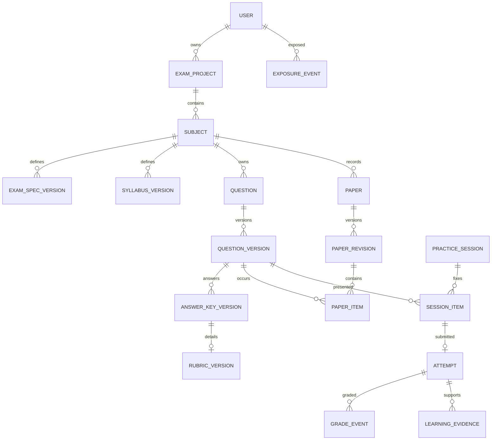

# AcePass 数据与接口契约

本文中的字段、枚举和规则为开发契约；Django 模型名可用 PascalCase，数据库表名遵守项目命名规范。示例 ID 为说明占位，实际使用 UUID。P0 不要求提前创建所有 P1/P2 表，但必须保留已发生的版本、来源、评分和暴露事实。

## 1. 全局约束

1. 所有业务对象显式归属项目或可经受约束的外键得到项目；创建和读取均验证对象链属于同一 owner/project/subject。不能把 A 项目的答案或附件绑定到 B。
2. 所有时间使用带时区 UTC；用户时区用于日期展示和“今日”边界。分数为 `Decimal`，API 传十进制字符串；时长用毫秒整数。规则内定义每题下限、满分、舍入方式和整卷下限。
3. 正式题目、答案、rubric、考纲和已使用考试规范均不可原地修改。草稿可编辑；已发布内容生成后继版本，并保留修订原因。
4. 题目内容身份、真实考试发生记录、学习会话题项、用户作答四者分离。
5. 判分、暴露、模型调用和审计事件追加保存；学习状态与报告是可重建投影。每次作答只有一个受版本控制的当前有效正式评分事件。
6. P0 不提供业务硬删除接口；支持归档/撤回。后续账户数据删除需单独设计级联和保留规则。

## 2. 实体关系



### 2.1 身份、项目与考试

| 实体 | 核心字段/约束 | 阶段 |
|---|---|---|
| `user_settings` | user 唯一；timezone；daily_budget_minutes；项目预算分配 | P0 |
| `exam_project` | owner；name；target_date 可空；target_score 可空；active/archived | P0 |
| `subject` | project；name；显示顺序 | P0 |
| `exam_spec_version` | subject；version；total_score；pass_score 可空；question_type_rules；时间规则；draft/published | P0 |
| `syllabus_version` | subject；name/version；适用周期；source_document 可空；审核状态 | P0 |
| `paper` | subject；cycle_key；session_key；paper_code；source_kind；真实考试稳定身份；effective_revision_id | P0 |
| `paper_revision` | paper；revision；spec_version；完整性/确认人；status | P0 |
| `paper_item` | revision；position_key；parent_item 可空；question_version；answer_key_version；max_score；是否计分 | P0 |

试卷唯一自然键为 `(subject, cycle_key, session_key, paper_code)`，相同身份不能因文件名变化新增；冲突由人工确认“同卷修订还是不同卷”。同一 revision 的 `position_key` 唯一；paper.effective_revision_id 必须指向自身版本，切换时锁定 paper 并记录审计，每张真实试卷只有一个统计有效版本。生成题禁止挂到 `source_kind=official_past` 的真题发生记录。P0 手工登记试卷和年份，P1 基于这些发生记录统计。

一个 paper 对应一个科目；多科考试通过多份 paper 表示。完整周期要求按考试规范登记该周期预期场次/卷别，人工确认均覆盖，不能仅因上传一份完整试卷就判断全年完整。没有已知预期场次时周期为 `coverage_unknown`。

### 2.2 来源、内容和标签

| 实体 | 核心字段/约束 | 阶段 |
|---|---|---|
| `source_document` | owner/project；私有对象 key；hash；MIME；大小；source_type；来源说明；使用范围；文档角色 | P0 |
| `source_region` | document；page_index（从 1 开始）；bbox 归一化坐标；crop_key；区域角色 | P0 |
| `import_job` | project；输入文件或文字文档；解析版本；状态；问题列表；进度；重试次数 | P0 |
| `import_candidate` | job；候选结构；source_region 列表；校对问题；reviewer；publication_result | P0 |
| `question` | subject；稳定 ID；origin_type；current_published_version；family；content_lineage_id | P0 |
| `question_version` | question；version；type；stem_blocks；options/blank_specs；parent_material_version；material_child_version_ids；practice_max_score；estimated_seconds；status | P0 |
| `question_source_link` | question_version；region；stem/answer/material 等角色；多个区域可跨页 | P0 |
| `answer_key_version` | question_version；version；answer_payload；source_type；verification_status；checked_by/at；source_region | P0 |
| `rubric_version` | answer_key_version 一对零或一；criteria；每项分值/依赖/上限；总分 | P0 |
| `question_family` | subject；name；关系确认状态；revision；近重复/换数题归一 | P0 |
| `content_lineage` | owner；已知同题/明确复制的稳定关联；依据与确认状态；跨本人项目使用 | P0 |
| `question_pool_policy` | user/project/family；training/holdout；revision；变更原因 | P0 基础，P2 启用正式封存 |
| `knowledge_node` | syllabus_version；parent；kind=chapter/point；canonical_name；aliases；审核状态 | P0 |
| `question_template` | subject；名称；考查方式；人工确认状态 | P0 |
| `question_knowledge` | question_version；mapping_revision；node；主/辅助；score_weight；template | P0 |
| `verification_pairing` | project/subject/node；基准题可空；即时题；延迟题；版本；reviewer；delay_hours；有效状态 | P0 |
| `prerequisite_edge` | 同一大纲内前置→目标；类型；review_status；拒绝自环及环路 | P1 |

文本粘贴也创建原始文档，保留原文和 offset；不能只有解析后内容没有来源。题干块只允许 text/math/image/table 等结构，资产必须来自本项目已审核的题干区域。选项固定 `id`，空位固定 `blank_id`。

`origin_type` 区分 `official_past / licensed_bank / user_authored / ai_generated / demo`；原始文件的来源声明与审核状态分开。`answer_key.source_type` 为 `official / textbook_or_bank / user / ai_derived`；`verification_status` 为 `pending / checked / disputed`。checked 必须记录与当前题号/版本匹配确认及依据；AI 答案需人工/可复核工具独立验证，不能靠同模型多次一致直接 checked。

已发布的叶子计分题只能使用经核对题干及 `checked` 答案（大题还需 checked rubric）；无可信答案的内容保留在探讨/待处理视图，不进入计分、验证或能力投影。`material` 父题是例外：无答案、无分值、无 attempt，只校验共享材料、来源和有序子题版本清单；父子须同项目/科目且无循环。父子可在同一事务完成整组发布，所有叶子分别满足发布条件。会话仅为叶子创建可提交题项并固定材料版本。题目无大纲时可以使用明确的“用户自建暂定大纲”，但不能冒充官方覆盖分析。

独立练习分值从 `question_version.practice_max_score` 获取；发布前若未填写，可显式采用并保存题型规范的 default_max_score。无两者时必须补填，不能从科目总分推断。基于 paper_item 创建会话时用该发生记录的分值，否则用题目练习分值；结果写入 session_item。填空各空/大题 rubric 总分必须与本次计分单位一致，不一致拒绝建题项，不能静默缩放。需要不同满分时提供对应受审核的答案/rubric 版本。

已知同源重复导入、明确复制和人工确认同题可共享用户范围的 content_lineage；近重复仍由 family 管理。谱系只在同一 owner 的授权项目内关联，不通过全局哈希暴露其他用户资料。学习状态独立，首次接触资格则检查该用户已知谱系的跨项目暴露；未完成匹配时显示陌生度待确认，不承诺检测所有外部接触。

每个叶子计分单元的归属权重之和为 1；P0 未分类部分分配给显式“未分类”节点，不能丢失分值。辅助标签可以权重为 0，不能额外重复得分。映射修订是单独批次，不改变历史 question_version 的正文。

### 2.3 学习、评分与审计

| 实体 | 核心字段/约束 | 阶段 |
|---|---|---|
| `practice_session` | user/project/subject；mode=practice/verification/mock_exam；状态；策略版本；exam_deadline 可空 | P0，mock_exam P2 |
| `session_item` | session；ordinal；题目/答案/rubric/spec/映射版本；max_score；用途；首次下发时间；draft + draft_revision | P0 |
| `attempt` | session_item 唯一；raw_answer；steps；attachments；confidence；submitted_at；计时数据；请求摘要 | P0 |
| `grade_event` | attempt；kind；status；逐项/已确认分值；待评分值；答案/规则版本；grading_revision；supersedes；操作者 | P0 |
| `exposure_event` | user/project；question/family/version/lineage；kind；purpose；source；server_time；session_item 可空 | P0 |
| `error_diagnosis` | attempt；候选类型；证据指针；model/user/reviewer 来源；proposed/confirmed/rejected | P0 |
| `learning_evidence` | attempt；effective_grade；规则版本；各证据维度；排除原因；生效/失效 | P0 |
| `learner_knowledge_state` | user/project/syllabus/node 唯一；各维度计数；当前/历史状态；needs_review；projection_version；as_of | P0 |
| `study_plan` / `study_task` | user/date；预算/轮换偏移/规则快照；项目/题项/考点；pairing_version；origin_session_item_id；trigger_event；delay_anchor_at；not_before；原因；due_at；estimated_minutes；状态 | P0 |
| `tutor_session` / `tutor_turn` | user/project/session_item 必填；attempt 可空、提交后关联；purpose；请求/经校验回答；引用；llm_run；状态 | P0 |
| `review_card` / `review_log` | user/project/node；FSRS 状态与版本；rating；UTC 复习时间；不可变日志 | P1 |
| `llm_run` / `content_revision` | 调用和内容修订审计，保留输入版本与主体 | P0 |
| `idempotency_record` / `outbox_event` | 请求作用域、键、摘要、结果引用；派发及消费状态 | P0 |
| `report_snapshot` / `recompute_run` | 计算版本、输入版本集合/水位、过滤条件、时点、状态 | P0 基本，P1/P2 扩展 |

唯一性：`(user, route_scope, idempotency_key)`；`(session, ordinal)`；`session_item -> attempt` 一对零或一。一次重做新建题项，不覆盖 attempt。无用户动作不得复制昨日未完成任务，`(user, project, task_kind, source_event, scheduled_slot)` 防重复。

## 3. 内容状态机与发布事务

```text
导入：queued → processing → awaiting_review → completed
                       ↘ failed / cancelled
题目：draft → in_review → published → withdrawn
                   ↘ draft（退回修正）
答案：pending → checked；pending/checked → disputed
```

`completed` 表示候选均已发布或被明确忽略；OCR 结束但还需校对仅是 awaiting_review。未校对的题干、选项缺失、配图缺失、答案冲突、rubric 总分不符、计分权重不符都阻止发布。

发布事务锁定候选与版本，校验同一项目/科目/大纲、题型结构、答案可信度、评分规则和来源；发布版本、记录审计和 outbox 事件一起提交。同一 publish 幂等请求不得创建多个版本。

答案从 checked 变 disputed：立即停止新增计分会话题项，当前会话提交仍保存原始作答但置待复核，受影响历史证据标记失效/待重算。已发布正文变更创建新版本；旧记录按当时版本可回看，不自动改写。

## 4. 判分精确契约

### 4.1 统一返回

```json
{
  "attempt_id": "uuid",
  "grade_event_id": "uuid",
  "status": "pending_review",
  "method": "deterministic",
  "confirmed_score": "2.00",
  "max_score": "5.00",
  "pending_max_score": "3.00",
  "is_fully_confirmed": false,
  "parts": [
    {"part_id": "blank_1", "score": "2.00", "status": "confirmed", "method": "deterministic"},
    {"part_id": "blank_2", "score": null, "status": "pending_review", "method": null}
  ],
  "evidence_status": "excluded_pending_grade"
}
```

`status`: `confirmed / pending_review / estimated / void`；`method`: `deterministic / self_confirmed / reviewer_confirmed / ai_estimated / mixed`；尚未评分的 part.method 可为 null。混合评分的每个 part 保留方法，顶层用 `mixed`；任何自评分项使整题不能进入严格独立证据。AI 估计独立字段 `estimated_score`，不能填到 confirmed_score。

“完全正确”要求全部分项确认且达到满分；部分分不能直接计为独立正确。负分只在用户选定支持负分的规则时允许，成绩不低于规则下限；整卷是否封底为 0 由版本化考试规则定义，不能隐式 clamp。

### 4.2 可实现的规则模板

| 模板 | 完整定义 |
|---|---|
| 单选/判断 | 正确得 max_score；错误按 wrong_score（默认 0）；未答按 blank_score（默认 0） |
| 多选完全匹配 | 非空提交集合等于标准集合得满分；包含错误项得 wrong_score；未选得 blank_score；其余得 0 |
| 多选少选部分分 | 全部选对满分；非空严格子集得配置的 partial_score；含错误项得 wrong_score；未选得 blank_score |
| 填空精确 | 每空定义 accepted_values、允许的归一化开关、max_score；不匹配时依据 mismatch_policy=wrong/review |
| 填空数值 | Decimal 解析；abs(x-a) <= max(abs_tol, rel_tol*abs(a))；单位白名单和换算因子显式配置；解析失败/单位未知待复核 |
| 大题人工 | 每个 criterion 给定 0..max_score；明确的部分分刻度与评分依赖；全项确认后求和，拒绝超限 |

默认填空 mismatch_policy 为 review，只有考试规则能明确判错时才选 wrong。表达式如 `1/2` 不默认等同数值 `0.5`；P0 可在可接受答案中显式登记或人工确认。禁止 `eval` 执行填空表达式。填空空位无序匹配 P0 不支持，界面按固定空位输入并声明限制；不以错误实现冒充支持。

项目必须主动选定计分模板并核对参数，不能因为 UI 默认就宣称符合真实考试。P0 超出以上模板的专业规则采用人工复核。AI 估计与最终人工确认使用两个 grade_event；人工确认不能修改原模型事件。

### 4.3 幂等、修正与重判

提交在一个事务里完成：锁定 session_item → 检查会话可提交和幂等键 → 保存 attempt → 生成确定性/待复核 grade_event → 更新当前正式评分指针 → 保存投影 outbox。大题人工确认是第二个幂等操作，必须提交 expected_grading_revision 及固定答案/rubric 版本，使用同一锁和版本检查，过期页面返回 409。评分者就是答题者时一律 self_confirmed；另一位获授权内部 staff 才可记 reviewer_confirmed，不能仅看 is_staff 判断。

verification/mock_exam 在整个会话结束前仅返回 submitted/received 状态，隐藏所有分数、正误、rubric、诊断及可推导答案的评分细节；attempt 查询、报告和 Admin 同样执行此约束。practice 返回评分反馈时，记录 feedback_delivered：若该反馈可反推出答案（例如判断题），进一步按答案暴露处理。后台评分可先持久化，但前端反馈由会话用途门禁决定。

同键同载荷返回同一结果；同键异载荷 409；不同键向同一已提交题项重提也返回已提交冲突，不再评分。请求超时后客户端用同键查询/重试。

答案修正先创建已审核新版本；重判任务指定目标答案、规则和 `grading_revision`。保留原 attempt 和初始引用，新增 superseding grade_event。只有当前目标 revision 的结果能通过行锁/比较交换更新有效指针；早发晚到的旧任务不得覆盖新结果。

重判重建学习证据、状态与报告，旧报告保存时点和修订提示。题干变化不能机械用新题答案重判旧题作答：原题错误/缺条件时将该作答证据失效并说明；仅答案或评分纠错在相容题干上重判。标签/家族修正则重建归属或污染结论，不重复追加作答次数。

## 5. 暴露与学习证据

### 5.1 暴露事实

事件 kind 至少有 `stem_delivered / hint_delivered / explanation_delivered / answer_delivered / feedback_delivered / editorial_preview / external_seen`。以服务端实际提供内容为保守标准，不依赖用户点击上报；仅模型内部生成但没返回给用户不算用户暴露，不过封存内容进入训练用途模型输入本身就是隔离违规，另记审计。

只有创建会话 POST 创建 session_item，先返回 ID 与版本清单，不批量下发全部题干。通过题项呈现接口领取当前题干时写 first_delivered_at/stem_delivered；恢复同一题项不重置首次时间。题库 GET 预览只记暴露，不创建题项。禁用前端未审计的题干预取。该次当前题项首次呈现是本次作答的一部分，不使本次“系统内首次接触”自动失败；在此之前的其他预览/作答才使它失去首次接触资格。用户放弃或未提交，呈现事件也保留，不能重新标为从未见过。

提交前辅助暴露跨所有标签页、会话、项目内家族关系及同一用户跨项目已知内容谱系检查。题目版本更新或复制到另一项目不会使同一内容重新成为新题。本人提交之后查看答案自评，不能倒推为提交前看过，但自评评分来源仍限制证据级别。

### 5.2 证据维度与默认判定

| 维度 | 资格 |
|---|---|
| 重复练习 | 原始提交存在；即使看过答案仍可统计完成，但单列 |
| 无辅助完成 | 本次作答开始至提交没有提示/答案等辅助；不等同从未看过该题 |
| 严格独立作答 | 可信题与确认评分；本次无辅助；开始前未见本题答案/解析、未预览本题；用时满足该用途要求；非自评/AI估计 |
| 同模板变式 | 不同稳定 question；模板相同；明确标注家族是否相同，不能当严格封存迁移 |
| 陌生变式 | 严格独立且题目变化经审核、非近重复；至少覆盖第二种模板；家族未知则“待确认” |
| 延迟验证 | 合格作答相对于该考点最近训练/教学已过 >=24 小时；题目自身从未学过可支持延迟迁移，旧题仅支持重复保持 |
| 严格封存测验 | P2，首次测验前整个家族无既往训练/编辑暴露，来源可靠、考试模式、判分可确认 |

延迟间隔锚点为当前题项呈现之前最后一次相关作答或教学事件；中途查看讲解会更新锚点。多考点题逐考点判断。用时不可信或后台停留无法排除时，不能生成达标限时证据；原始作答仍保留。

状态摘要为规则函数而非 LLM 输出：未诊断；确认存在基础缺失时需要补基础；仅有辅助成功时提示后完成；至少 1 道严格独立正确时可独立；至少 2 道严格独立正确且两种已确认模板时有陌生变式证据；至少 3 道不同题、两种模板且有延迟正确时经过延迟验证。展示实际计数，避免一次成功暗示稳定能力。

最近 3 次相关严格独立尝试中至少 2 次失败时置 needs_review 并将当前摘要降为“需要复习”；历史最高状态保留。内容撤回、评分更正可导致更严格回退。所有阈值作为规则版本保存，修改后重建投影。

P2 封存以 user/project/family 为单位，覆盖题库列表、预览、推荐、检索、AI 输入、导出、缓存、原始文件。测验一旦呈现题目即消耗首次资格；家族合并后重新检查污染。个人亲自校对过的题只能称练习，不能称严格未见。

## 6. 今日计划与复习

P0 先用确定顺序：到期验证/复习 → 已确认薄弱点的人工配对题 → 未诊断考点题 → 其他练习。任务附 reason_codes、证据 IDs、预计时长和规则版本。跳过待评分、争议/撤回、不适用大纲、封存或已达重复上限的题。

全局预算先按项目比例分配整数分钟，用最大余数法补齐。同余数的项目基础顺序按日期/创建时间确定，再以“用户当地日期距 1970-01-01 的天数 mod 活动项目数”循环移位；计划保存项目集合与偏移，同日重试复用快照，防止固定偏爱同一项目。项目分配余额若放不下一道合格题，汇入共享余额，按当日轮换顺序一次分配给能完整容纳下一题的项目；仍放不下则保留空闲并解释，不跨日累计形成未来超预算。

项目内为未诊断内容预留 20% 时间（可配，向下取整）；预算不足以容纳任何一题时记录“配额不足”，不强加任务，P1 可优化多日公平性。缺合格题时剩余时间可用于其他类别并记录原因。预计超出剩余预算的题不能强加；未完成任务保留，过量到期任务顺延并展示积压数量。大题默认预计 15 分钟、填空 3 分钟、选择/判断 2 分钟，由题目或项目配置覆盖；不得把这些初值声称为实测。

P0 由 Admin 维护 verification_pairing，将基准题/考点与即时 B、延迟 C 题关联并审核。同一 pair 的题必须属于同项目/科目，B/C 与基准题稳定 ID 不同，暴露资格执行时再次检查。用户完成基准题的讲解/解析后创建即时任务；若无需辅导，首次确认评分触发即时任务。B 提交并获得确认评分后创建 C 的延迟任务，不要求 B 一定正确，失败时增加补弱建议。以 `(user, pairing_version, origin_session_item_id, task_kind)` 唯一约束幂等生成，并保存实际 trigger_event；提交前讲解也已有题项，无需伪造 attempt。A 的讲解、重复读取、后续评分和重判只能对应一个 B；C 以 B 的题项为 origin，同样不得重复。记录当时最近相关教学/作答事件作为 delay_anchor_at，not_before=anchor+delay_hours。后续相关训练使锚点变新时，未开始延迟任务的 not_before 向后更新并记录原因；开始前仍复核真实间隔。无可用配对题创建缺题记录，不用原题冒充陌生验证。

生成计划接口默认返回当日现存计划。显式 refresh 创建计划修订，仅替换未开始任务，已完成/进行中任务保留。题目答案修正、归档等使任务失效时标明原因，不从历史中删除。

P1 可使用如下可解释规则替换项目内排序，参数全部版本化：

```text
priority = exam_weight * weakness * improvability / max(estimated_minutes, 1)
           + 0.2 * min(overdue_days, 7) / 7
```

`exam_weight` 为适用大纲权重和完整真题分值占比的配置混合，资料不足回退已知考点等权并注明；`weakness` 为近期确认失分率、样本不足单列；`improvability` 冷启动固定 1，不让 LLM 随意估计。前置依赖、覆盖、重复上限和时间预算优先于排序分数。这个分数不是预期提分。

## 7. 历年统计口径（P1）

统计输入是每个真实 paper 的一个有效 revision 中的叶子计分 `paper_item`，过滤 demo、AI 生成、重复导入、无效大纲和有争议映射。原题跨年出现保留多次发生记录，同卷重复导入只保留一次。

`考点得分容量(k,y) = Σ item.max_score * item.knowledge_weight(k)`。

年度占比的分母为同一纳入集合、同一科目的试卷实际计分满分之和；不能拿部分题目分值除整年未知满分。完整性不满足时单独显示“已导入材料占比”，不冒充完整年度占比。

默认选择最近 5 个确认完整且可比较的大纲适用考试周期，不硬编码年份；同时展示最近周期中被排除的缺失/不完整周期，不能悄悄只挑有数据的旧年。少于 5 个就展示实际数量；大纲变化时分组或说明不可直接比较。

辅助考点出现频次可以另算，但不增加其 score_weight；父材料题不再加分。未分类分值在总分校验中保留并展示，分值归属总和须等于有效题项满分之和。所有统计由 SQL/Python 完成，LLM 只能解释已算好的结果。

## 8. API 总则

前缀 `/api/v1`，项目路径采用 `/projects/{project_id}`。所有响应使用类型化 schema 并生成 OpenAPI；正式题干 DTO、编辑 DTO、答案 DTO 分开，不能复用一个含答案的模型后依靠前端隐藏。

错误形状：`{"error":{"code":"...","message":"...","details":{},"request_id":"..."}}`。400 业务输入无效；401 未登录；403 已知用途不允许/CSRF；404 对象不在请求权限范围；409 幂等/版本冲突；422 结构校验失败；429 限流；503 依赖不可用。列表分页默认 20、最多 100，带 total；禁止不受控全量返回。

除草稿幂等 PUT 外，所有可能重复产生业务效果的 POST 要求 `Idempotency-Key`。草稿/编辑 PATCH 使用 revision 或 If-Match，过期修改返回 409。GET 不改变评分或计划；题干实际下发作为访问审计可追加暴露事件。

### 8.1 P0 路由

| 方法与路径（相对 /api/v1） | 契约 |
|---|---|
| `GET /auth/csrf`，`POST /auth/login`，`POST /auth/logout`，`GET /auth/me` | Session + CSRF；登录限流；P0 账户由管理命令创建 |
| `GET/PATCH /me/study-settings` | 时区、总预算和项目分配；校验有效项目和比例 |
| `GET/POST /projects`，`GET/PATCH /projects/{p}`，`POST /projects/{p}/archive` | 仅本人；归档前检查活动会话 |
| `GET/POST /projects/{p}/subjects` | 同项目科目 |
| `GET/POST /projects/{p}/exam-spec-versions`、`/syllabus-versions` | 指定 subject；审核并发布新版本，编辑草稿 |
| `POST /projects/{p}/exam-spec-versions/{id}/publish`、`/syllabus-versions/{id}/publish` | 同作用域版本化发布 |
| `POST /projects/{p}/assets`，`GET /projects/{p}/assets/{id}` | 上传返回资产 ID；下载检查角色/用途，原始答案文件受限 |
| `POST /projects/{p}/imports`，`GET /projects/{p}/imports/{id}` | 输入 `text` 或 `asset_ids`；202 返回 job ID/状态/问题 |
| `POST /projects/{p}/imports/{id}/retry` | 可恢复失败；复用来源、阻止重复候选 |
| `GET/PATCH /projects/{p}/import-candidates/{id}` | 校对结构与来源；乐观锁 |
| `POST /projects/{p}/import-candidates/{id}/publish` | 事务发布题目版本和答案，返回稳定 IDs |
| `GET /projects/{p}/questions`，`GET /projects/{p}/questions/{id}` | 列表仅元数据、不预取正文；详情预览题干记暴露；均无答案、rubric、正确标记 |
| `POST /projects/{p}/questions/{id}/revisions`，`PATCH /projects/{p}/question-versions/{id}` | 已发布题新建草稿；PATCH 仅草稿 |
| `POST /projects/{p}/question-versions/{id}/publish`、`/withdraw` | 内容发布/撤回，同一领域服务 |
| `GET/POST /projects/{p}/knowledge-nodes`、`/question-templates` | 最小考点/模板维护；映射审核可经 Admin |
| `GET/POST /projects/{p}/papers`，`GET /projects/{p}/papers/{id}` | 手工登记真题身份、版本、题项；详细编辑经 Admin 领域动作 |
| `POST /projects/{p}/practice-sessions` | `mode, subject_id, task_id或question_ids`；服务端选择固定版本；返回题项 ID/版本清单，不预取题干 |
| `GET /projects/{p}/practice-sessions/{id}` | 恢复草稿/状态；用途检查 |
| `GET /projects/{p}/session-items/{id}/presentation` | 返回当前题干/材料及安全资源；首次领取固定开始时间并记录暴露，重读不重置 |
| `PUT /projects/{p}/session-items/{id}/draft` | `draft_revision, answer, steps, asset_ids`；返回新 revision |
| `POST /projects/{p}/session-items/{id}/submit` | 只接收作答、信心、计时遥测；practice 返回 attempt + GradeResult；验证/考试未结束只回收讫状态 |
| `GET /projects/{p}/attempts/{id}` | 本人原始作答；验证/考试未结束隐藏评分/诊断，结束后才可读取 |
| `POST /projects/{p}/session-items/{id}/reveal` | practice 可在提交前查看答案/完整解析，记录辅助暴露；验证/考试禁止 |
| `POST /projects/{p}/attempts/{id}/reveal` | 提交后请求可信答案/解析，记录暴露；验证结束前禁止 |
| `POST /projects/{p}/attempts/{id}/confirm-grade` | expected_grading_revision、答案/rubric 版本、评分点及评语；本人永远 self，异人授权才 reviewer；过期 409 |
| `POST /projects/{p}/attempts/{id}/diagnosis` | 用户确认/否认候选或自报原因；不改正式评分 |
| `POST /projects/{p}/tutor-sessions`，`POST /projects/{p}/tutor-sessions/{id}/messages` | 必绑练习题项、attempt 可空；practice 提交前允许提示/完整讲解，分别标记辅助/答案暴露；验证中拒绝 |
| `GET /projects/{p}/tutor-jobs/{id}` | 返回校验后内容或明确失败；AI 无配置返回可操作状态 |
| `POST /projects/{p}/practice-sessions/{id}/finish` | 结束会话；验证完成后可 reveal；幂等 |
| `GET /study-plans/today`，`POST /study-plans/today/generate` | 总预算下的跨项目任务，GET 无计划则返回空态 |
| `POST /study-tasks/{id}/start`、`/defer` | 任务仍归属 owner/project；start 校验题目是否仍有效 |
| `GET /projects/{p}/learning-states`、`/review-tasks`、`/reports/practice` | 证据与不足说明；过滤维度/时间/科目 |
| `POST /projects/{p}/regrades`，`GET /projects/{p}/regrades/{id}` | 指定受审核修正及影响范围；重判状态与受影响数量 |

答案编辑及 rubric/映射/家族维护可先通过受控 Admin 页面完成，但必须调用服务并做编辑暴露记录。普通 API 不提供无条件 `GET answer`。会话为 verification/mock_exam 时，所有并行入口（包括 Admin 编辑预览）需拒绝获取相关题答案，或要求先结束验证并标记污染；单纯隐藏辅导按钮无效。

### 8.2 提交示例

```http
POST /api/v1/projects/{p}/session-items/{item}/submit
Idempotency-Key: client-generated-uuid
X-CSRFToken: csrf-token
Content-Type: application/json
```

```json
{
  "answer": {"type": "multiple_choice", "selected_option_ids": ["opt_a", "opt_c"]},
  "steps": [],
  "asset_ids": [],
  "confidence": "unsure",
  "client_active_ms": 42000
}
```

填空 answer 为 `{"type":"fill_blank","blanks":{"b1":"-2","b2":"0.5"}}`；判断为 `{"type":"true_false","value":false}`；大题为 `{"type":"constructed_response","text":"原始解题过程"}` 并附 asset_ids。服务端从 session_item 取标准答案/分值/模式；请求中的 type 必须与题目一致。服务器记录 elapsed_ms 与客户端 active_ms，后者仅为遥测，不决定正式考试截止时间。

### 8.3 P1/P2 扩展路由

P1：`GET /projects/{p}/analysis`；`POST /projects/{p}/review-cards/{id}/reviews`；`POST /projects/{p}/attempts/{id}/estimate-grade`；`GET /projects/{p}/tutor-jobs/{id}/events`；PDF 导入沿用 imports。

P2：`POST /projects/{p}/variant-candidates` 及审核发布；`POST /projects/{p}/mock-exams`；`PUT /projects/{p}/mock-exams/{id}/answers`；`POST /projects/{p}/mock-exams/{id}/submit`；`GET /projects/{p}/mock-exams/{id}/report`。考试期间保存草稿不反馈正确性，交卷/超时后一次性评分；服务端截止时间和整卷锁防止重复交卷。

正式接口由实现生成 OpenAPI，与这些业务约束保持一致；新增路由必须补充用途与答案暴露边界，不能绕开会话模式。
