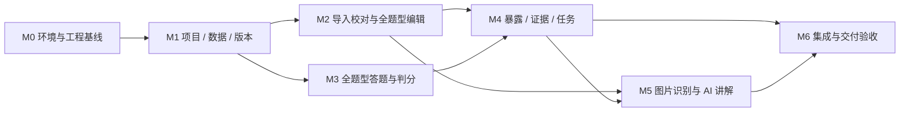

# AcePass 实施任务与交付顺序

## 1. 执行约定

先实现完整 P0，再按 P1/P2 迭代。每个里程碑要有可运行路径、相关测试和简短交付记录；不要只生成所有模块空壳，也不要同时做未验收的高级能力。具体开发时长取决于执行环境、题型规则及模型接入，本方案不提供未经验证的工期承诺。

每次工作开始检查实际文件和已有改动，避免覆盖其他人的代码。本目录在规划时为空，不意味着 DeepSeek 接手时仍为空。文档中的应用命令是待实现的交付接口，不是本次已执行验证的命令。

## 2. P0 的依赖图

M2 和 M3 可以在 M1 契约稳定后并行。暴露事件契约在 M1 固定，M2/M3 的内容下发当时就记事件；M4 负责消费证据，不能等到 M4 才补历史日志。

## 3. P0 任务卡

### M0：工程、环境与真实状态

**产物**：前后端工程、依赖锁文件、Compose、环境模板、基础 CI、README 运行说明。

- Python/Django/Ninja/PostgreSQL 采用架构基线，核对兼容性；前端选定匹配的受支持 Node/React/Vite 版本，记录在锁文件和运行配置。
- 配置后端模块、类型化 API、前端路由/Query 客户端、KaTeX 安全渲染、统一错误处理。
- 数据库从第一天使用 PostgreSQL，核心事务测试也跑 PostgreSQL，不用 SQLite 替代关键一致性测试。
- Compose 配置持久化卷、健康检查、私有网络、应用/Worker 分角色启动；无 AI 配置也能启动。
- 准备账户创建命令、Session + CSRF、明确的测试/演示环境开关。无默认公开管理员密码。
- 为后续任务提供格式、类型、构建和测试命令；写 `docs/implementation-status.md`，区分未做/实现/自动化通过/真实集成通过。

**完成条件**：空数据库可迁移启动；登录后可进入无项目空态；未登录不能访问业务 API；前端构建和后端基础测试通过；记录实际依赖版本。对应 A01、A02、A35。

### M1：多项目与领域数据

**依赖**：M0。

**产物**：领域模型、约束、迁移、项目设置页、Admin 受控动作、服务层。

- 实现多个项目及科目、用户预算、各科规范/大纲版本。
- 实现来源文件/区域、候选、题目/答案/rubric 版本、练习分值、模板/家族/内容谱系/用途策略、考点映射和配对验证关系。
- 实现 paper / paper_revision / paper_item，支持手工登记跨年度发生记录。
- 实现会话题项、原始作答、判分/暴露事件、幂等记录、outbox 的基础数据与事务接口。
- 确定安全 DTO、项目外键一致性校验、P0 owner 与内部 staff 权限。
- 正式版本修订/撤回统一走服务；Admin 不开放直接改已发布正文和评分事实。

**完成条件**：两个项目可设置不同评分规则；跨作用域绑定被拒绝；已发布版本不可原地修改；父子题分数、考点权重、试卷身份受约束。对应 A03—A05、A13、A14、A23、A24。

### M2：导入、校对和全部题型内容管理

**依赖**：M1。自动图片识别由 M5 完成，本阶段先交付人工路径。

**产物**：题库、导入状态页、校对页、全题型编辑器。

- 支持文本原文和图片私有保存；手动录入及解析候选可编辑。
- 支持单选、多选、判断、多空填空、大题 rubric、共享材料及子题；允许保留多页来源区域。
- 原图/识别结果对照，列出缺项、负号/单位疑点、答案冲突和重复候选。
- 审核时记录题干/答案编辑暴露；只有可信答案及完整题目可发布练习版本。
- 对同文件/同试卷重复导入提示复用或继续校对，不静默制造新的真实考试。
- 使用经过核对的安全题干裁图；来源整页和答案附件不能混进练习资源。

**完成条件**：五种题型均可人工录入、发布、查询并追溯原文/原图；问题题无法误入练习；重复导入不翻倍。对应 A06—A09、A13、A24、A26。

### M3：全题型工作台与正式评分

**依赖**：M1；最终与 M2 内容流程联调。

**产物**：桌面/手机工作台、草稿、提交、自动评分、人工评分页。

- 全部题型正确展示及输入；多选用稳定 ID、判断 false 不当空值；填空按空位录入；大题文字/步骤/附件。
- 服务端会话快照固定题目、答案、rubric、规则与分值；按题项实际领取记录开始时间，禁止提前批量下发；草稿带修订号避免多标签覆盖。
- 实现确定性评分适配器及部分待评；大题按 rubric 自评或 staff 复核，保留评分来源。
- 实现幂等提交、人工确认、答案修订重判和旧任务防覆盖；原始作答不覆写。
- practice/verification 模式由服务端控制；验证完成前隐藏分数和正误，也不能通过题库/附件/辅导/编辑接口旁路取答案。
- 练习中允许提交前请求完整解析并记辅助暴露；验证完成后才可 reveal，原图与答案引用也需用途授权。

**完成条件**：同一用户在两个项目完成五类题的全流程；填空无法自动判断时待复核；大题正式总分逐点可追溯；并发提交、重判无重复计分。对应 A03、A10—A22、A26—A28。

### M4：证据、补弱任务和报告

**依赖**：M2、M3。

**产物**：学习证据服务、今日计划、考点页、错题与复习、练习报告。

- 消费暴露/作答/正式评分，按数据契约计算独立性、陌生度、延迟与限时维度及排除原因。
- 支持错误原因候选的用户确认/否定，缺证据保持未知。
- 考点摘要附证据清单；失败或重判能降级；自评不与严格独立证据混算。
- 通过 verification_pairing 人工维护配对验证题，缺题有清晰状态；以确认评分/讲解事件幂等触发即时题，B 确认评分后生成 >=24 小时后的 C 题，并持久化延迟锚点。
- 按全局预算分配多个项目；固定排序、覆盖配额、重复上限、顺延及计划刷新语义可解释。
- 报告区分完整确认、部分待评、自评、辅助作答、重复练习和系统内首次接触。

**完成条件**：在可注入时钟下跑通 A→辅导/人工解析→B→次日 C；跨项目预算不超额；更正答案后状态/报告不累加旧事件。自动化推进时钟只证明逻辑，真实隔天学习效果另行记录。对应 A19—A22、A25、A29—A33。

### M5：图片识别与按需辅导

**依赖**：M2、M4。

**产物**：Provider 接口、真实可配置适配器、结构输出 schema、提示词版本、模型审计、独立队列。

- 单题图片输出候选结构、来源位置和识别疑点；无视觉能力或失败时回到人工校对。
- 辅导输出关键条件、卡点候选、方法与适用边界、下一步验证；单凭错选不确定诊断。
- 给提示、完整讲解和澄清条件都经过权限/用途检查；没有可靠答案只允许明确的探讨，不写评分或掌握状态。
- 经校验内容轮询展示；提示/答案暴露由后端记录。个性化缓存隔离用户、项目和作答上下文。
- 实现超时、限次重试、费用记录、输入版本过期判断和模型未配置时降级。
- 明确测试 stub、演示和真实 provider 的不同运行模式，禁止自动退回假回答后仍显示真实成功。

**完成条件**：有凭据时，至少一条真实图片导入和一条真实讲解经过人工核验；无凭据时完成自动化和手动核心流程并标记真实 AI 集成未验证，不能称完整 AI 验收。对应 A07、A19、A26、A28、A34、A36。

### M6：可重复交付与 P0 总验收

**依赖**：M0—M5。

**产物**：可启动完整版本、自动化验收结果、真实试用记录、恢复验证、已知限制。

- 准备两项目、至少两科、至少 30 个可评分叶子题的演示/金标夹具；人工核对答案、rubric、来源和评分规则。
- CI 运行必要单元、PostgreSQL 集成和浏览器主路径；验证错误状态，不能只拍静态页面。
- 真实浏览器完成多项目切换、图片校对、五题型作答、人工评分、提示、配对题、任务与报告。
- 模拟宕机/重投，确认没有丢失作答或重复发布；数据库和媒体备份在空目录恢复成功。
- 更新 README 的实际启动/测试/备份/恢复命令；记录支持/未支持范围、真实 AI 验证和延迟实测状态。

**完成条件**：验收文档的全部 P0 业务/安全/一致性用例通过；真实模型项状态如实披露；不把未来 24 小时测试、长期提分或未配置 provider 宣称通过。无凭据阻塞只影响 AI 真实验证，不能停下其他可独立完成的工作。

## 4. P1 任务

进度状态更新于 2026-09-27（批次划分与判据见 [17 走向 100% 的计划](17-remaining-plan-to-completion.md)）。

| ID | 内容 | 依赖与完成条件 | 状态 |
|---|---|---|---|
| P1-01 | 原生文字 PDF 批量导入、答案页匹配候选 | P0；错误匹配可校对，批量任务可恢复、无重复发布 | **已交付**（`docs/16`，验收 B03） |
| P1-02 | 大纲词表、AI 候选标签、前置关系 | P0；同义词合并、环依赖拒绝、候选需审核 | **已交付**：词表与人工映射（`docs/16`）、前置关系与标签候选（`docs/18`） |
| P1-03 | 五个完整周期分析、覆盖缺口 | P1-01/02；按真实发生记录统计、权重不重复、缺失明确 | **已交付**（`docs/16`，验收 B01/B02） |
| P1-04 | 中文关键词 + 向量混合检索 | P0；权限/封存先过滤，离线集对比召回质量；无向量仍可用 | **已交付**（`docs/18` §3，验收 B05；真实嵌入模型未验证） |
| P1-05 | FSRS 主动回忆卡和可解释推荐 | P0、P1-02/03；卡片与能力证据独立；全局预算仍受限 | **已交付**（`docs/18` §4，验收 B06） |
| P1-06 | 诊断追问、手写转写确认、AI rubric 估分 | P0；转写确认后才诊断，估分与正式分分离；人工复核 | 批次 3（验收 B07） |
| P1-07 | 经校验分段 SSE 和重连 | P0；断线不重复付费调用，未经验证内容不外流 | 批次 3（验收 B08） |

## 5. P2 任务

| ID | 内容 | 完成条件 | 状态 |
|---|---|---|---|
| P2-01 | 扫描 PDF、多栏、跨页、图表与公式 | 金标逐类回归；失败区域进入校对，不承诺全自动 | 批次 4（验收 C01） |
| P2-02 | AI 生成变式及独立校验 | 标签/来源/可解性/唯一答案/大纲检查；人工或有效工具验证；不进真题统计 | 批次 5（验收 C02） |
| P2-03 | 家族封存与污染检测 | 所有入口统一过滤；校对暴露、整页原图、家族合并可追踪 | 批次 5（验收 C03） |
| P2-04 | 限时模拟考试与正式报告 | 服务端时钟、草稿、一次性交卷；未交卷不反馈答案；待评和失效题单列 | 批次 6（验收 C05/C06） |
| P2-05 | 受限数学判分和专业题型插件 | 资源限制、允许语法、单位/符号回归；不确定转人工，无任意代码执行 | 批次 6（验收 C07） |
| P2-06 | 效果评估与参数校准 | 可比试卷/时间/题型/暴露条件，报告样本和局限；不依据正确率编造通过概率 | 批次 6（验收 C08） |

本地 GPU 部署和共享题库只有实际需求确认后才增加任务；不会因为原文提到 4090 就在未知机器上安装服务。

## 6. 每个里程碑的交付记录

执行者更新 `docs/implementation-status.md`，每个条目记录：实现范围、相关文件、数据库迁移、实际测试命令和结果、可复现操作、未完成项、是否有真实模型/真题/实际时间证据。

可先完成 M0—M1 的基础，再接续整个 P0，不要求用户为每个常规步骤再次确认。遇到会改变产品范围的选择才询问；模型密钥等必要输入缺失时继续不依赖它的工作，最终明确缺项。
